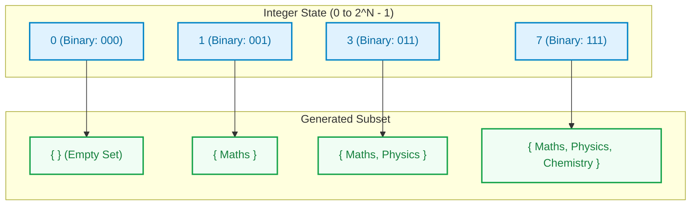
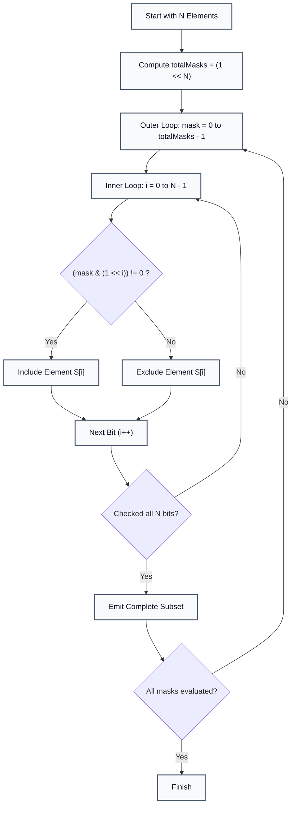

# Bitwise Representation: Power Set Generation

> **Summary:**  
> The Bitwise Representation algorithm generates all possible subsets (the power set) of a given set of elements.  
> It uses the binary bits of an integer counter as on/off flags to determine element inclusion in $\mathcal{O}(1)$ auxiliary space.

---

## 1. Definition

A **Power Set** $\mathcal{P}(S)$ is the set of all subsets of a set $S$, including the empty set $\emptyset$ and $S$ itself.  
For a set containing $N$ elements, the power set contains exactly $2^N$ subsets.

* Each element has two mutually exclusive states: included ($1$) or excluded ($0$).
* Any integer from $0$ to $2^N - 1$ contains a unique binary representation of $N$ bits.
* The $i$-th bit of an integer determines whether the $i$-th element of set $S$ is present in that subset.



### The Technical Problem
Recursive backtracking or building tree combinations requires function call stack overhead $\mathcal{O}(N)$ and dynamic memory allocation.  
Iterative bit manipulation solves this problem without recursion, using register-level bitwise operations.

---

## 2. Procedure

The algorithm executes an outer loop over all $2^N$ integers and an inner loop checking each bit:

1. **Step 1:** Calculate the total number of subsets: `total = 1 << N` ($2^N$).
2. **Step 2:** Iterate a counter `mask` from $0$ to `(1 << N) - 1`.
3. **Step 3:** For each `mask`, evaluate each bit position $i \in [0, N - 1]$ using bitwise AND: `(mask & (1 << i)) != 0`.
4. **Step 4:** If the condition evaluates to true, include element $S[i]$ in the current subset.



---

## 3. Step-by-Step Code and Description

All code examples refer to [`algorithms/dp/bitmask.java`](file:///Users/manthan/Desktop/DSA3/algorithms/dp/bitmask.java).

---

### Part 1: Compute Total Combinations via Bitshift

The bitwise left shift `1 << n` multiplies $1$ by $2^n$ in a single CPU cycle:

```java
String[] subjects = { "Maths", "Physics", "Chemistry", "English", "ComputerScience" };
int n = subjects.length; // n = 5
int total = 1 << n;      // 1 << 5 = 32
```

---

### Part 2: State Enumeration and Bit Isolation

The inner condition isolates the $i$-th bit of `mask` by creating a single-bit mask `1 << i`:

```java
for (int mask = 0; mask < (1 << n); mask++) {
    System.out.print("{ ");

    for (int i = 0; i < n; i++) {
        // Test if i-th bit is active (1)
        if ((mask & (1 << i)) != 0) {
            System.out.print(subjects[i] + " ");
        }
    }
    System.out.println("}");
}
```

```mermaid
sequenceDiagram
    autonumber
    participant Loop as Outer Loop (mask)
    participant Tester as Bit Tester (1 << i)
    participant Output as Console Output

    Loop->>Tester: Evaluate mask = 5 (binary 00101)
    Tester->>Tester: i=0: 00101 & 00001 = 00001 (Non-zero)
    Tester->>Output: Emit "Maths"
    Tester->>Tester: i=1: 00101 & 00010 = 00000 (Zero)
    Tester->>Output: Skip "Physics"
    Tester->>Tester: i=2: 00101 & 00100 = 00100 (Non-zero)
    Tester->>Output: Emit "Chemistry"
    Tester-->>Loop: Subset complete: { Maths Chemistry }
```

---

## 4. Execution Trace

Given $S = \{\text{Maths}, \text{Physics}, \text{Chemistry}, \text{English}, \text{ComputerScience}\}$ ($N = 5$):

| Mask (Decimal) | Binary String ($b_4 b_3 b_2 b_1 b_0$) | Active Bit Indices | Resulting Subset |
| :---: | :---: | :---: | :--- |
| `0` | `00000` | None | `{ }` (Empty Set) |
| `1` | `00001` | $0$ | `{ Maths }` |
| `2` | `00010` | $1$ | `{ Physics }` |
| `3` | `00011` | $0, 1$ | `{ Maths, Physics }` |
| `5` | `00101` | $0, 2$ | `{ Maths, Chemistry }` |
| `7` | `00111` | $0, 1, 2$ | `{ Maths, Physics, Chemistry }` |
| `31` | `11111` | $0, 1, 2, 3, 4$ | `{ Maths, Physics, Chemistry, English, ComputerScience }` |

---

## 5. Technical Complexity

| Parameter | Value | Technical Reason |
| :--- | :--- | :--- |
| **Time Complexity** | $\mathcal{O}(N \cdot 2^N)$ | The outer loop executes $2^N$ iterations. The inner loop evaluates $N$ bit positions per mask. |
| **Space Complexity** | $\mathcal{O}(1)$ | Operates in-place using two scalar integer variables (`mask` and `i`). No recursive call stack or extra collections required. |

---

## 6. Technical Questions and Answers

* **Question: Why do we test `(mask & (1 << i)) != 0` instead of `== 1`?**  
  **Answer:** The bitwise operation `mask & (1 << i)` evaluates to $2^i$, not $1$ (for example, when $i = 2$, it evaluates to $4$). Checking `!= 0` verifies that the bit is active regardless of its power-of-two magnitude.

* **Question: Can we test bits using right shifts instead of left shifts?**  
  **Answer:** Yes. The condition `((mask >> i) & 1) == 1` shifts the target bit to the least significant position and checks for equality with $1$.

* **Question: What is the upper bound on $N$ for bitmasking with standard Java integers?**  
  **Answer:** A standard Java `int` is a 32-bit signed integer, limiting practical masks to $N \le 30$. For $N \le 62$, a 64-bit `long` (`1L << i`) is used. For $N > 64$, `java.util.BitSet` or `BigInteger` must be used.
