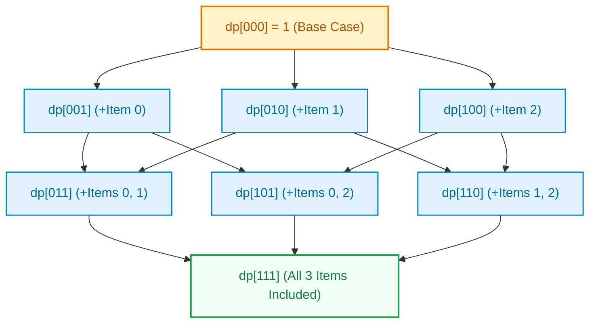
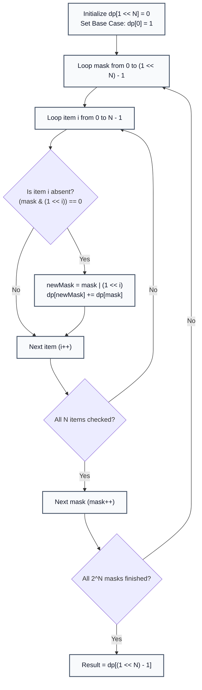
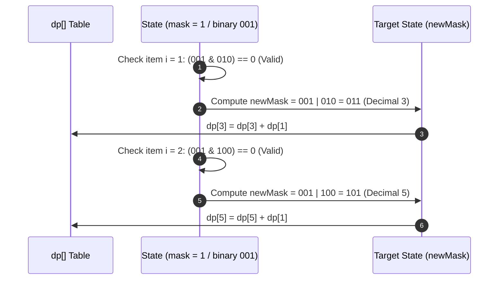

# Subset Dynamic Programming (Bitmask DP)

> **Summary:**  
> Subset Dynamic Programming computes optimal solutions or counts valid configurations across sub-states of a set.  
> It uses an integer bitmask as the array index `dp[mask]`, where each bit represents the presence or absence of an element.

---

## 1. Definition

**Subset DP** is a dynamic programming technique where subproblems correspond to distinct subsets of a set of $N$ elements.  
Instead of tracking multi-dimensional arrays or visited flags, a single integer bitmask serves as the state identifier.

* **State Representation:** `dp[mask]` represents the computed value (e.g., total valid permutation orderings, minimum cost, or reachable paths) for the subset encoded by `mask`.
* **State Space:** For $N$ items, there are exactly $2^N$ states: `dp[0]` to `dp[(1 << N) - 1]`.
* **Transitions:** Moving from `mask` to `newMask` by including an unvisited element $i$ (`newMask = mask | (1 << i)`).



### The Technical Problem
Brute-force permutations for $N$ items scale at $\mathcal{O}(N!)$ (factorial complexity).  
By caching intermediate solutions in a table indexed by subset bitmasks, Bitmask DP reduces complexity from factorial $\mathcal{O}(N!)$ to exponential $\mathcal{O}(N \cdot 2^N)$.

---

## 2. Procedure

The algorithm tabulates solutions incrementally from smaller subsets to larger subsets:

1. **Step 1:** Initialize an array `dp` of size $2^N$ (`1 << n`) with zeros.
2. **Step 2:** Set the base case: `dp[0] = 1` (one way to form the empty set).
3. **Step 3:** Iterate through all subset states `mask` from $0$ up to $2^N - 1$.
4. **Step 4:** For each active state, check every item $i \in [0, N - 1]$ that is **not** currently included: `(mask & (1 << i)) == 0`.
5. **Step 5:** Compute the forward transition:
   $$\text{newMask} = \text{mask} \mid (1 \ll i)$$
   $$\text{dp}[\text{newMask}] = \text{dp}[\text{newMask}] + \text{dp}[\text{mask}]$$
6. **Step 6:** Read the final result at `dp[(1 << n) - 1]`, representing all $N$ elements included.



---

## 3. Step-by-Step Code and Description

All code examples refer to [`algorithms/dp/subset.java`](file:///Users/manthan/Desktop/DSA3/algorithms/dp/subset.java).

---

### Part 1: Table Allocation and Base State

The array size is defined by `1 << n`:

```java
int n = 3;
int totalmasks = 1 << n; // 2^3 = 8

int[] dp = new int[totalmasks];
dp[0] = 1; // 1 way to order 0 elements
```

---

### Part 2: Forward Dynamic Programming Transitions

The nested loop evaluates forward state transitions:

```java
for (int mask = 0; mask < totalmasks; mask++) {
    for (int i = 0; i < n; i++) {
        // If element i is not yet included in the current mask
        if ((mask & (1 << i)) == 0) {
            int newMask = mask | (1 << i);
            dp[newMask] += dp[mask];
        }
    }
}
System.out.println("Total orders = " + dp[totalmasks - 1]);
```



---

## 4. Execution Trace

Given $N = 3$ elements ($0, 1, 2$):

| `mask` | Binary | `dp[mask]` | Transitions Generated (`newMask`) | Updated Target States |
| :---: | :---: | :---: | :--- | :--- |
| `0` | `000` | $1$ | $i=0 \to 1$, $i=1 \to 2$, $i=2 \to 4$ | `dp[1]=1`, `dp[2]=1`, `dp[4]=1` |
| `1` | `001` | $1$ | $i=1 \to 3$, $i=2 \to 5$ | `dp[3]=1`, `dp[5]=1` |
| `2` | `010` | $1$ | $i=0 \to 3$, $i=2 \to 6$ | `dp[3]=2`, `dp[6]=1` |
| `3` | `011` | $2$ | $i=2 \to 7$ | `dp[7]=2` |
| `4` | `100` | $1$ | $i=0 \to 5$, $i=1 \to 6$ | `dp[5]=2`, `dp[6]=2` |
| `5` | `101` | $2$ | $i=1 \to 7$ | `dp[7]=4` |
| `6` | `110` | $2$ | $i=0 \to 7$ | `dp[7]=6` |
| `7` | `111` | $6$ | None (All bits set) | Terminal answer: $3! = 6$ |

**Final Output:** `Total orders = dp[7] = 6` ($3!$).

---

## 5. Technical Complexity

| Parameter | Value | Technical Reason |
| :--- | :--- | :--- |
| **Time Complexity** | $\mathcal{O}(N \cdot 2^N)$ | The outer loop runs $2^N$ times. For each state, $N$ candidate transitions are tested. |
| **Space Complexity** | $\mathcal{O}(2^N)$ | Requires a one-dimensional DP array of size $2^N$ to store state solutions. |
