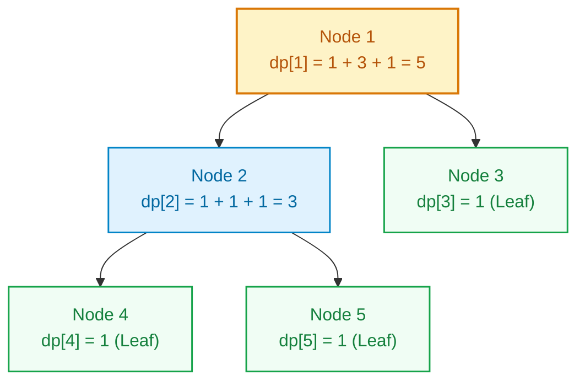
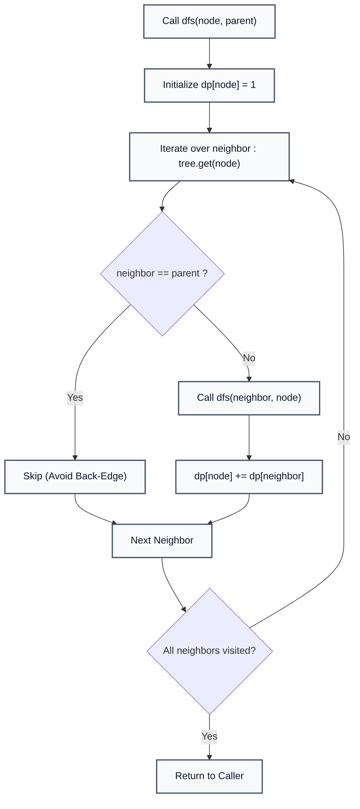
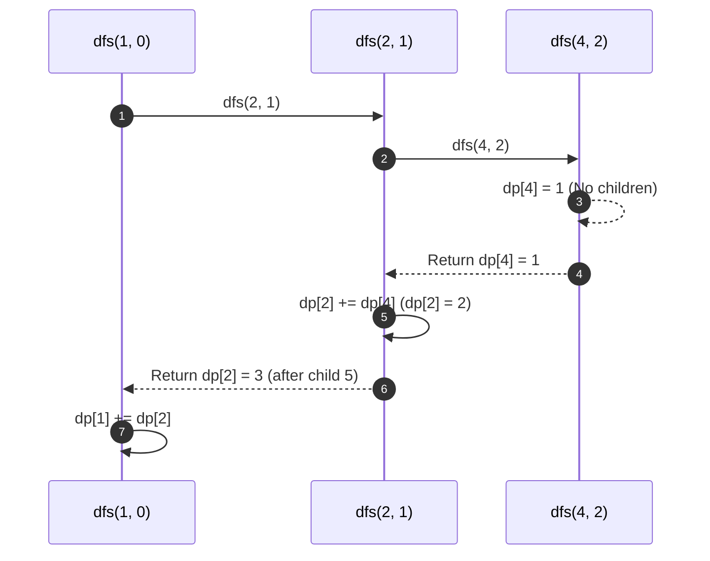

# Tree Dynamic Programming (Subtree Size Aggregation)

> **Summary:**  
> Tree Dynamic Programming solves optimization and aggregation problems on tree graphs.  
> It uses post-order Depth-First Search (DFS) to compute subproblem values for child subtrees before aggregating them at the parent node.

---

## 1. Definition

A **Tree** is an undirected, connected acyclic graph containing $N$ vertices and $N - 1$ edges.  
In **Tree DP**, subproblems are defined recursively over the rooted subtrees of the tree graph.

* **Subproblem Definition:** `dp[u]` represents the size of the subtree rooted at vertex $u$ (including vertex $u$ itself).
* **Base Case:** A leaf node has no children; therefore, `dp[leaf] = 1`.
* **State Transition:** For any internal vertex $u$ with children $v_1, v_2, \dots, v_k$:
  $$\text{dp}[u] = 1 + \sum_{v \in \text{children}(u)} \text{dp}[v]$$



### The Technical Problem
Trees lack a natural linear order (unlike arrays or strings).  
Tree DP resolves this by designating a root node, which induces a strict ancestor-descendant hierarchy and enables post-order evaluation.

---

## 2. Procedure

The algorithm executes a single post-order DFS traversal from the designated root:

1. **Step 1:** Build the tree as an undirected adjacency list `tree`.
2. **Step 2:** Start DFS at the root node ($u = 1$) with parent $p = 0$.
3. **Step 3:** Initialize the current node's subproblem: `dp[u] = 1` (counting itself).
4. **Step 4:** Iterate through each neighbor `child` in `tree.get(u)`:
   * If `child == parent`, skip to prevent traversing back up the tree.
   * Otherwise, recursively invoke `dfs(child, u)`.
   * After the recursive call returns, accumulate the child's subtree size: `dp[u] += dp[child]`.
5. **Step 5:** Return to the caller. When DFS finishes, `dp[root]` holds the total number of nodes in the entire tree.



---

## 3. Step-by-Step Code and Description

All code examples refer to [`algorithms/dp/TreeDp.java`](file:///Users/manthan/Desktop/DSA3/algorithms/dp/TreeDp.java).

---

### Part 1: Post-Order Subtree DFS Function

```java
static List<List<Integer>> tree;
static int[] dp;

static void dfs(int node, int parent) {
    // 1. Base initialization (node counts itself)
    dp[node] = 1;

    // 2. Traverse child subtrees
    for (int child : tree.get(node)) {
        if (child != parent) {
            dfs(child, node);
            // 3. Post-order aggregation
            dp[node] += dp[child];
        }
    }
}
```



---

## 4. Execution Trace

For the 5-node tree rooted at node 1 with edges $(1,2), (1,3), (2,4), (2,5)$:

1. **Visit Node 1:** Set `dp[1] = 1`. Recurse to child 2.
2. **Visit Node 2:** Set `dp[2] = 1`. Recurse to child 4.
3. **Visit Node 4:** Leaf node. `dp[4] = 1`. Returns to 2.  
   $\to$ `dp[2] = 1 + 1 = 2`.
4. **Visit Node 5:** Leaf node. `dp[5] = 1`. Returns to 2.  
   $\to$ `dp[2] = 2 + 1 = 3`. Returns to 1.  
   $\to$ `dp[1] = 1 + 3 = 4`.
5. **Visit Node 3:** Leaf node. `dp[3] = 1`. Returns to 1.  
   $\to$ `dp[1] = 4 + 1 = 5`.

| Node | Children | Computed `dp[node]` Value | Subtree Description |
| :---: | :---: | :---: | :--- |
| **4** | None | $1$ | Leaf $\{4\}$ |
| **5** | None | $1$ | Leaf $\{5\}$ |
| **3** | None | $1$ | Leaf $\{3\}$ |
| **2** | $4, 5$ | $1 + 1 + 1 = 3$ | Subtree $\{2, 4, 5\}$ |
| **1** | $2, 3$ | $1 + 3 + 1 = 5$ | Full tree $\{1, 2, 3, 4, 5\}$ |

---

## 5. Technical Complexity

| Parameter | Value | Technical Reason |
| :--- | :--- | :--- |
| **Time Complexity** | $\mathcal{O}(V + E) = \mathcal{O}(N)$ | In a tree, $E = N - 1$. Each vertex is visited once and each edge is traversed twice (forward and backtrack). |
| **Space Complexity** | $\mathcal{O}(N)$ | Adjacency list requires $\mathcal{O}(N)$ space; recursion call stack takes $\mathcal{O}(H)$ where $H$ is tree height ($H \le N$). |
