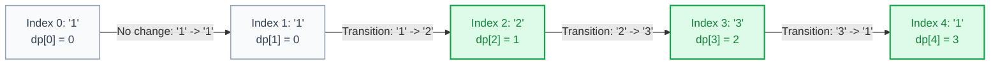
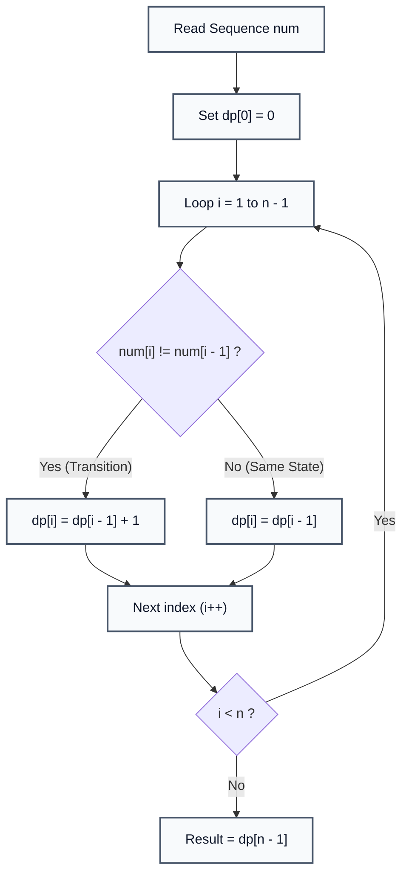

# Transaction Dynamic Programming (State Transition Tracking)

> **Summary:**  
> Transaction Dynamic Programming models sequential changes of state over time or sequence positions.  
> It tracks cumulative state boundaries and transition counts using 1D dynamic programming memoization in $\mathcal{O}(N)$ time.

---

## 1. Definition

A **State Transition (Transaction)** occurs when a continuous sequence changes its state or category from index $i - 1$ to index $i$.  
In sequential dynamic programming, tracking transitions allows systems to partition streams, calculate switching costs, or monitor boundary changes.

* **Sequence:** A discrete input sequence $S = s_0, s_1, s_2, \dots, s_{n-1}$.
* **DP State:** `dp[i]` represents the total number of distinct state transitions observed from index $0$ through index $i$.
* **State Transition Equation:**
  $$\text{dp}[i] = \begin{cases} 0 & \text{if } i = 0 \\ \text{dp}[i - 1] + 1 & \text{if } s[i] \ne s[i - 1] \\ \text{dp}[i - 1] & \text{if } s[i] = s[i - 1] \end{cases}$$



### The Technical Problem
In transaction processing, stock trading, and signal processing, systems must evaluate boundary penalties or state changes across millions of sequential events.  
1D tabulation solves this incrementally in a single linear pass.

---

## 2. Procedure

The algorithm executes a single forward pass over the sequence:

1. **Step 1:** Read input sequence string `num` of length $n$.
2. **Step 2:** Allocate a 1D DP array `dp` of length $n$.
3. **Step 3:** Set the base case: `dp[0] = 0` (zero transitions at the first element).
4. **Step 4:** Iterate index $i$ from $1$ to $n - 1$:
   * Compare character `num.charAt(i)` with predecessor `num.charAt(i - 1)`.
   * If different, record a transaction: `dp[i] = dp[i - 1] + 1`.
   * If identical, maintain previous count: `dp[i] = dp[i - 1]`.
5. **Step 5:** Read `dp[n - 1]`, which provides the total transition count across the entire sequence.



---

## 3. Step-by-Step Code and Description

All code examples refer to [`algorithms/dp/TransactionDp.java`](file:///Users/manthan/Desktop/DSA3/algorithms/dp/TransactionDp.java).

```java
String num = "11231";
int n = num.length();

int[] dp = new int[n];
dp[0] = 0; // Base case

for (int i = 1; i < n; i++) {
    if (num.charAt(i) != num.charAt(i - 1)) {
        dp[i] = dp[i - 1] + 1; // Transition occurred
    } else {
        dp[i] = dp[i - 1];     // Stable state
    }
}
```

---

## 4. Execution Trace

For the input sequence `"11231"` ($n = 5$):

| Index $i$ | Character `num[i]` | Predecessor `num[i-1]` | State Comparison | `dp[i]` Value | Description |
| :---: | :---: | :---: | :---: | :---: | :--- |
| **0** | `'1'` | — | Base Case | `0` | Starting element |
| **1** | `'1'` | `'1'` | `'1' == '1'` | `0` | State persists |
| **2** | `'2'` | `'1'` | `'2' != '1'` | `1` | Transition 1: '1' $\to$ '2' |
| **3** | `'3'` | `'2'` | `'3' != '2'` | `2` | Transition 2: '2' $\to$ '3' |
| **4** | `'1'` | `'3'` | `'1' != '3'` | `3` | Transition 3: '3' $\to$ '1' |

**Resulting DP Array:** `[0, 0, 1, 2, 3]`.  
**Total Transitions:** `3`.

---

## 5. Technical Complexity

| Parameter | Value | Technical Reason |
| :--- | :--- | :--- |
| **Time Complexity** | $\mathcal{O}(N)$ | A single linear loop executes $N - 1$ constant-time comparisons. |
| **Space Complexity** | $\mathcal{O}(N)$ | Stored in an array of size $N$. (Can be optimized to $\mathcal{O}(1)$ space using a single accumulator variable). |

---

## 6. Technical Questions and Answers

* **Question: How does this concept generalize to Buy/Sell Stock problems (e.g. Best Time to Buy and Sell Stock)?**  
  **Answer:** In transaction DP for stocks, each transition represents changing state between *holding cash* and *holding stock*, subtracting transaction fees or transition costs at state boundary changes.

* **Question: Can the space complexity be reduced?**  
  **Answer:** Yes. Since `dp[i]` only depends on `dp[i - 1]`, we can replace the array with an `int transitions` accumulator, achieving $\mathcal{O}(1)$ space.
