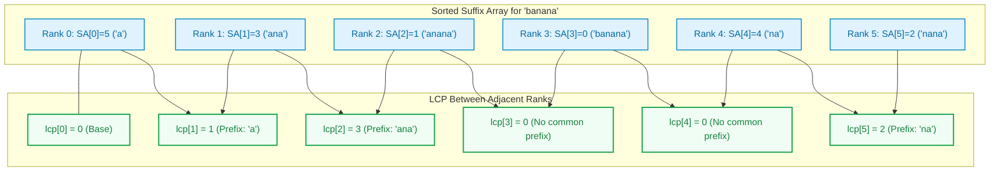
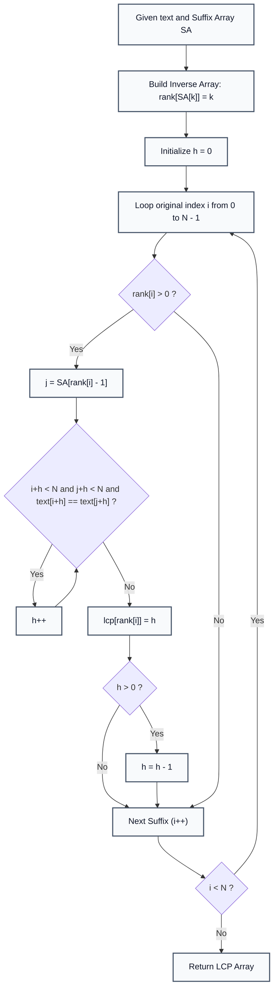

# Kasai's Algorithm: Longest Common Prefix (LCP) Array Construction

> **Summary:**  
> Kasai's Algorithm computes the Longest Common Prefix (LCP) array from a string and its Suffix Array in linear time $\mathcal{O}(N)$.  
> It relies on the mathematical invariant that the LCP value decreases by at most $1$ when advancing from suffix $i$ to suffix $i + 1$.

---

## 1. Definition

Given a string $S$ and its sorted **Suffix Array** $\text{SA}$, the **LCP Array** is an integer array of length $N$ where:
* `lcp[0] = 0` (no previous suffix exists).
* For $k > 0$, `lcp[k]` stores the length of the longest common prefix between consecutive sorted suffixes:
  $$\text{lcp}[k] = \text{LCP}(S[\text{SA}[k] \dots N-1], S[\text{SA}[k-1] \dots N-1])$$



---

## 2. Procedure and the Invariant

All code examples refer to [`algorithms/strings/KasaiAlgorithm.java`](file:///Users/manthan/Desktop/DSA3/algorithms/strings/KasaiAlgorithm.java).

### The Mathematical Invariant:
If the suffix starting at index $i$ has an LCP of $h$ with its predecessor in the suffix array, then the next suffix starting at index $i + 1$ must share at least $h - 1$ characters with its respective predecessor:
$$\text{LCP}(\text{suffix}_{i+1}, \text{prev}) \ge h - 1$$

Because of this property, we do not need to restart character comparisons from $0$ for suffix $i + 1$. We start comparing from $h - 1$, guaranteeing that the comparison pointer $h$ decrements at most $N$ times throughout the entire execution.

### Algorithm Steps:
1. **Step 1:** Construct the inverse suffix array `rank[]`, where `rank[SA[k]] = k`.
2. **Step 2:** Initialize pointer $h = 0$.
3. **Step 3:** Iterate original suffix indices $i$ from $0$ to $N - 1$:
   * If `rank[i] > 0`:
     * Identify the preceding sorted suffix index: `j = SA[rank[i] - 1]`.
     * While characters match ($S[i + h] == S[j + h]$), increment $h$.
     * Record `lcp[rank[i]] = h`.
     * If $h > 0$, decrement $h = h - 1$ before the next iteration.
4. **Step 4:** Return the completed `lcp` array.



---

## 3. Step-by-Step Code and Description

```java
public static int[] buildLCP(String text, int[] suffixArray) {
    int n = text.length();
    int[] lcp = new int[n];

    // 1. Build rank table (inverse suffix array)
    int[] rank = new int[n];
    for (int i = 0; i < n; i++) {
        rank[suffixArray[i]] = i;
    }

    int h = 0; // Length of current longest common prefix
    for (int i = 0; i < n; i++) {
        if (rank[i] > 0) {
            int j = suffixArray[rank[i] - 1]; // Preceding suffix in sorted order

            // Extend common prefix matches
            while (i + h < n && j + h < n && text.charAt(i + h) == text.charAt(j + h)) {
                h++;
            }

            lcp[rank[i]] = h;

            // Invariant: LCP for next suffix (i + 1) is at least h - 1
            if (h > 0) {
                h--;
            }
        }
    }
    return lcp;
}
```

---

## 4. Execution Trace

For the string `"banana"` ($N = 6$):
* `text = "banana"`
* `suffixArray = [5, 3, 1, 0, 4, 2]`
* `rank = [3, 2, 5, 1, 4, 0]`

| Suffix Index $i$ | Suffix $S[i \dots]$ | Sorted Rank | Preceding Suffix $j$ | Matching Prefix | $h$ Before | $h$ After Decrement | `lcp[rank]` |
| :---: | :--- | :---: | :--- | :---: | :---: | :---: | :---: |
| **0** | `"banana"` | $3$ | `"anana"` ($j=1$) | `""` | $0$ | $0$ | `lcp[3] = 0` |
| **1** | `"anana"` | $2$ | `"ana"` ($j=3$) | `"ana"` | $3$ | $2$ | `lcp[2] = 3` |
| **2** | `"nana"` | $5$ | `"na"` ($j=4$) | `"na"` | $2$ | $1$ | `lcp[5] = 2` |
| **3** | `"ana"` | $1$ | `"a"` ($j=5$) | `"a"` | $1$ | $0$ | `lcp[1] = 1` |
| **4** | `"na"` | $4$ | `"banana"` ($j=0$) | `""` | $0$ | $0$ | `lcp[4] = 0` |
| **5** | `"a"` | $0$ | None (First) | — | — | — | `lcp[0] = 0` |

**Final LCP Array:** `[0, 1, 3, 0, 0, 2]`.

---

## 5. Technical Complexity

| Parameter | Value | Technical Reason |
| :--- | :--- | :--- |
| **Time Complexity** | $\mathcal{O}(N)$ | The variable $h$ can increase at most $N$ times and decrease at most $N$ times across all iterations. Total comparisons $\le 2N$. |
| **Space Complexity** | $\mathcal{O}(N)$ | Requires storage for the `rank` array of size $N$ and the `lcp` array of size $N$. |
