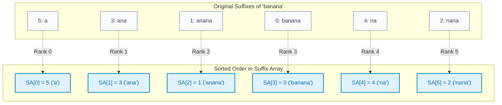
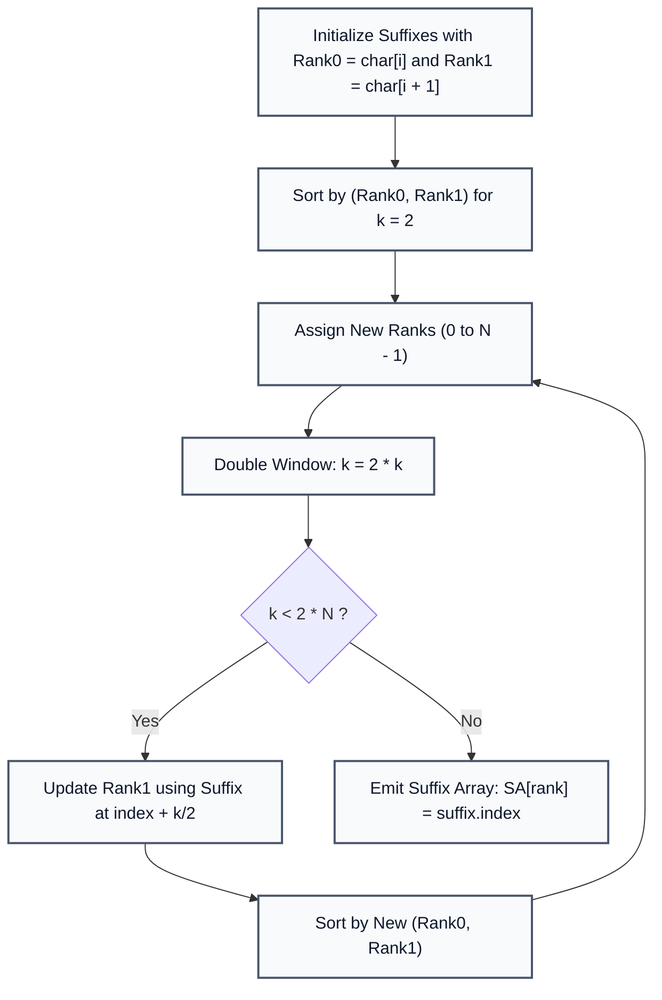

# Suffix Array Construction: Basics and Prefix Doubling

> **Summary:**  
> A Suffix Array stores the starting indices of all suffixes of a string sorted in lexicographical order.  
> It serves as a foundational index for rapid full-text pattern matching, substring search, and longest common prefix queries.

---

## 1. Definition

Given a string $S$ of length $N$, a suffix starting at index $i$ is denoted as $S[i \dots N - 1]$.  
The **Suffix Array** $\text{SA}$ is an integer array of length $N$ containing the permutation of indices $0, 1, \dots, N - 1$ such that:

$$S[\text{SA}[0] \dots N-1] < S[\text{SA}[1] \dots N-1] < \dots < S[\text{SA}[N-1] \dots N-1]$$



---

## 2. Procedure: Two Construction Methods

All code examples refer to [`algorithms/strings/SuffixArray.java`](file:///Users/manthan/Desktop/DSA3/algorithms/strings/SuffixArray.java).

### Approach 1: SA Construction Basics (Naive Sorting)
1. Generate an index array `sa = [0, 1, ..., N - 1]`.
2. Sort the array using a standard comparison function that compares strings `text.substring(a)` and `text.substring(b)`.
3. **Complexity:** Since string comparison takes $\mathcal{O}(N)$ time and sorting takes $\mathcal{O}(N \log N)$ comparisons, total time is $\mathcal{O}(N^2 \log N)$.

---

### Approach 2: SA Coding (Prefix Doubling Algorithm)
Instead of comparing full strings, Prefix Doubling sorts suffixes by prefixes of length $2^k$ ($1, 2, 4, 8, \dots$):

1. **Step 1 ($k = 0$):** Sort suffixes based on their first character ($2^0 = 1$). Assign rank pairs $(\text{rank}_0, \text{rank}_1)$ where $\text{rank}_0$ is the current character's rank, and $\text{rank}_1$ is the rank of the character at $i + 1$.
2. **Step 2 ($k = 1, 2, 3, \dots$):** At each step $2^k$, sort suffixes based on the tuple:
   $$(\text{rank of prefix of length } 2^{k-1}, \text{rank of second half of length } 2^{k-1})$$
3. **Step 3:** Reassign new integer ranks based on sorted pairs.
4. **Step 4:** Stop when $2^k \ge N$ or when all ranks are distinct.



---

## 3. Step-by-Step Code and Description

### Suffix Structure and Rank Assignment

```java
static class Suffix {
    int index;
    int rank0;
    int rank1;
}

// Initial sorting by first 2 characters
for (int i = 0; i < n; i++) {
    suffixes[i] = new Suffix();
    suffixes[i].index = i;
    suffixes[i].rank0 = text.charAt(i) - 'a';
    suffixes[i].rank1 = (i + 1 < n) ? (text.charAt(i + 1) - 'a') : -1;
}
Arrays.sort(suffixes, (a, b) -> {
    if (a.rank0 != b.rank0) return Integer.compare(a.rank0, b.rank0);
    return Integer.compare(a.rank1, b.rank1);
});
```

---

## 4. Execution Trace

For the string `"banana"` ($N = 6$):

| Final Rank | Suffix Index (`SA[i]`) | Suffix String |
| :---: | :---: | :--- |
| **0** | `5` | `"a"` |
| **1** | `3` | `"ana"` |
| **2** | `1` | `"anana"` |
| **3** | `0` | `"banana"` |
| **4** | `4` | `"na"` |
| **5** | `2` | `"nana"` |

**Output Suffix Array:** `[5, 3, 1, 0, 4, 2]`.

---

## 5. Technical Complexity

| Method | Time Complexity | Space Complexity | Technical Reason |
| :--- | :--- | :--- | :--- |
| **Naive Suffix Sorting** | $\mathcal{O}(N^2 \log N)$ | $\mathcal{O}(N)$ | Pairwise string comparison takes $\mathcal{O}(N)$ for each of the $N \log N$ sort steps. |
| **Prefix Doubling** | $\mathcal{O}(N \log^2 N)$ | $\mathcal{O}(N)$ | $\log N$ doubling phases. Each phase performs an $\mathcal{O}(N \log N)$ comparison sort. |
| **Prefix Doubling with Radix Sort** | $\mathcal{O}(N \log N)$ | $\mathcal{O}(N)$ | Uses two-pass counting sort on the rank pairs in each phase. |

---

## 6. Technical Questions and Answers

* **Question: How does a Suffix Array enable fast pattern searching?**  
  **Answer:** Because suffixes in the array are sorted alphabetically, binary search can locate any pattern of length $M$ in $\mathcal{O}(M \log N)$ time.

* **Question: What is the advantage of Suffix Array over a Suffix Tree?**  
  **Answer:** Suffix Arrays use significantly less memory (a simple 32-bit integer array of size $N$ vs. complex tree nodes with pointer overhead), making them much more cache-friendly.
