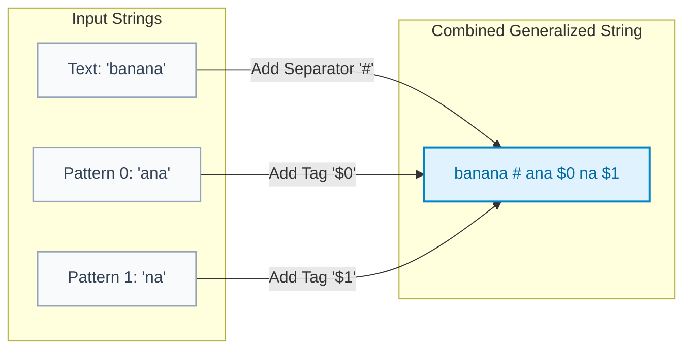
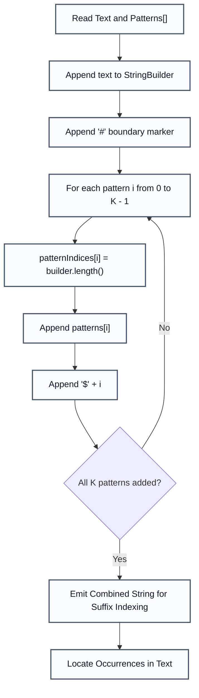

# Multi-Pattern Matching with Delimited Strings

> **Summary:**  
> Multi-Pattern Matching locates all occurrences of multiple search patterns within a primary text.  
> It uses unique delimiters to concatenate the text and all patterns into a single generalized string, converting multi-string search into a unified index query.

---

## 1. Definition

Given a primary text $T$ of length $N$ and a set of $K$ search patterns $P = \{p_1, p_2, \dots, p_K\}$, the goal of **Multi-Pattern Matching** is to find every index in $T$ where any pattern $p_j$ appears as a substring.

* **The Generalized String Concept:**  
  Instead of scanning the text $K$ independent times (taking $\mathcal{O}(K \cdot N)$ time), we construct a single combined string:
  $$S_{\text{combined}} = T + \text{"\#"} + p_0 + \text{"\$0"} + p_1 + \text{"\$1"} + \dots + p_{K-1} + \text{"\$(K-1)"}$$
* **Role of Unique Delimiters:**  
  Characters like `#` and `$` are distinct sentinel characters that do not appear in the alphabet of the text. They ensure that no pattern can match across the boundary between two adjacent strings.



---

## 2. Procedure

All code examples refer to [`algorithms/strings/MultiPatternMatching.java`](file:///Users/manthan/Desktop/DSA3/algorithms/strings/MultiPatternMatching.java).

1. **Step 1:** Initialize a `StringBuilder` with the base text: `text = "banana"`.
2. **Step 2:** Append a primary separator `#` to isolate the text from pattern queries.
3. **Step 3:** For each pattern $p_i$ with index $i$:
   * Record the start index of the pattern within the combined string.
   * Append pattern string $p_i$.
   * Append a unique termination marker (such as `$` followed by index $i$).
4. **Step 4:** Build the index (such as a Generalized Suffix Array or Aho-Corasick automaton) over the combined string.
5. **Step 5:** Any suffix originating in the text section that shares a common prefix with a suffix originating in a pattern section indicates an exact pattern occurrence.



---

## 3. Step-by-Step Code and Description

```java
String text = "banana";
String[] patterns = {"a", "ana", "anana", "banana", "na", "nana"};

// Construct: banana#a$0ana$1anana$2banana$3na$4nana$5
StringBuilder combinedBuilder = new StringBuilder(text);
combinedBuilder.append("#"); 

int[] patternIndices = new int[patterns.length];

for (int i = 0; i < patterns.length; i++) {
    patternIndices[i] = combinedBuilder.length();
    combinedBuilder.append(patterns[i]).append("$").append(i);
}

String combined = combinedBuilder.toString();
```

---

## 4. Execution Trace

Given `text = "banana"` and `patterns = ["a", "ana", "anana", "banana", "na", "nana"]`:

* **Combined String Generated:**  
  `banana#a$0ana$1anana$2banana$3na$4nana$5`

* **Occurrences Extracted in Text:**

| Pattern | Pattern String | Found Starting Indices in `"banana"` | Match Count |
| :---: | :--- | :--- | :---: |
| **0** | `"a"` | `1, 3, 5` | 3 |
| **1** | `"ana"` | `1, 3` | 2 |
| **2** | `"anana"` | `1` | 1 |
| **3** | `"banana"` | `0` | 1 |
| **4** | `"na"` | `2, 4` | 2 |
| **5** | `"nana"` | `2` | 1 |

---

## 5. Technical Complexity

| Parameter | Value | Technical Reason |
| :--- | :--- | :--- |
| **String Assembly Time** | $\mathcal{O}(N + \sum_{i=1}^K M_i)$ | Each character of the text and all $K$ patterns is appended once. |
| **Query Complexity** | $\mathcal{O}(M_i \log(N + \sum M_i))$ | Binary search over the generalized suffix array takes logarithmic time relative to the combined length. |
| **Space Complexity** | $\mathcal{O}(N + \sum_{i=1}^K M_i)$ | The combined string stores all characters and delimiter tokens. |

---

## 6. Technical Questions and Answers

* **Question: Why do we need unique delimiters for each pattern instead of the same delimiter `#` everywhere?**  
  **Answer:** Unique delimiters (like `$` followed by pattern ID) allow the algorithm to instantly identify which specific pattern created a match and guarantee that the end of one pattern cannot match the beginning of another.

* **Question: What is the alternative to concatenated generalized strings for multi-pattern search?**  
  **Answer:** The **Aho-Corasick Automaton**, which builds a Trie over all patterns and uses failure transitions to search the text in a single pass without altering the original text.
