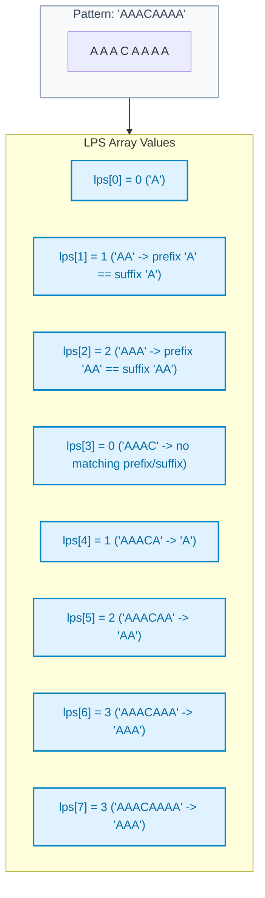
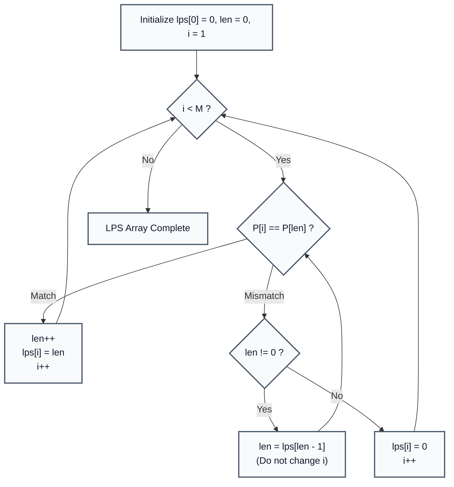

# Coding LPS: Longest Proper Prefix which is also Suffix Array

> **Summary:**  
> The LPS (Longest Proper Prefix which is also Suffix) array is the core precomputed lookup table in the Knuth-Morris-Pratt (KMP) family of string algorithms.  
> It computes the maximum length of matching prefix and suffix substrings in linear time $\mathcal{O}(M)$ without backtracking.

---

## 1. Definition

Given a pattern string $P$ of length $M$, a **Proper Prefix** is any prefix of $P$ that is not equal to $P$ itself.  
The **LPS Array** is an integer array of length $M$ where `lps[i]` stores the length of the longest proper prefix of $P[0 \dots i]$ that is identical to a suffix of $P[0 \dots i]$.

* `lps[0] = 0` always, because a single character has no proper prefix.
* For any index $i$, `lps[i]` identifies how many characters from the start of the pattern can be preserved when a character mismatch occurs.



---

## 2. Procedure and State Transitions

All code examples refer to [`algorithms/strings/LPSDemo.java`](file:///Users/manthan/Desktop/DSA3/algorithms/strings/LPSDemo.java).

The algorithm uses two pointers:
* `len`: The length of the previous longest prefix suffix.
* `i`: The current index being computed in the pattern string ($i \in [1, M - 1]$).

### Algorithm Steps:
1. Initialize `lps[0] = 0`, `len = 0`, and pointer `i = 1`.
2. While $i < M$:
   * **Case 1 (Character Match):** If $P[i] == P[\text{len}]$:
     $$\text{len} = \text{len} + 1$$
     $$\text{lps}[i] = \text{len}$$
     $$i = i + 1$$
   * **Case 2 (Character Mismatch):** If $P[i] \ne P[\text{len}]$:
     * If $\text{len} \ne 0$: fallback to the previous longest prefix suffix without incrementing $i$:
       $$\text{len} = \text{lps}[\text{len} - 1]$$
     * If $\text{len} == 0$: no prefix matches this suffix:
       $$\text{lps}[i] = 0$$
       $$i = i + 1$$



---

## 3. Step-by-Step Code and Description

```java
static int[] buildLPS(String pattern) {
    int n = pattern.length();
    int[] lps = new int[n];

    int len = 0; // length of previous longest prefix suffix
    int i = 1;

    // lps[0] is always 0
    while (i < n) {
        if (pattern.charAt(i) == pattern.charAt(len)) {
            len++;
            lps[i] = len;
            i++;
        } else {
            if (len != 0) {
                // Fall back to previous longest prefix suffix
                len = lps[len - 1];
            } else {
                lps[i] = 0;
                i++;
            }
        }
    }
    return lps;
}
```

---

## 4. Execution Trace

For the pattern `"AAACAAAA"` ($M = 8$):

| Index $i$ | Substring $P[0 \dots i]$ | Char $P[i]$ | Compared With $P[\text{len}]$ | Match? | Action Taken | `lps[i]` Value |
| :---: | :--- | :---: | :---: | :---: | :--- | :---: |
| **0** | `"A"` | `'A'` | — | — | Base Case | `0` |
| **1** | `"AA"` | `'A'` | $P[0] = \text{'A'}$ | Yes | `len++` ($1$), $i++$ | `1` |
| **2** | `"AAA"` | `'A'` | $P[1] = \text{'A'}$ | Yes | `len++` ($2$), $i++$ | `2` |
| **3** | `"AAAC"` | `'C'` | $P[2] = \text{'A'}$ | No | Fallback `len = lps[1] = 1` | — |
| **3** | `"AAAC"` | `'C'` | $P[0] = \text{'A'}$ | No | Fallback `len = lps[0] = 0` | — |
| **3** | `"AAAC"` | `'C'` | $P[0] = \text{'A'}$ | No | $\text{len} == 0 \to \text{lps}[3] = 0$, $i++$ | `0` |
| **4** | `"AAACA"` | `'A'` | $P[0] = \text{'A'}$ | Yes | `len++` ($1$), $i++$ | `1` |
| **5** | `"AAACAA"` | `'A'` | $P[1] = \text{'A'}$ | Yes | `len++` ($2$), $i++$ | `2` |
| **6** | `"AAACAAA"` | `'A'` | $P[2] = \text{'A'}$ | Yes | `len++` ($3$), $i++$ | `3` |
| **7** | `"AAACAAAA"` | `'A'` | $P[3] = \text{'C'}$ | No | Fallback `len = lps[2] = 2` | — |
| **7** | `"AAACAAAA"` | `'A'` | $P[2] = \text{'A'}$ | Yes | `len++` ($3$), $i++$ | `3` |

**Final LPS Array Output:** `[0, 1, 2, 0, 1, 2, 3, 3]`.

---

## 5. Technical Complexity

| Parameter | Value | Technical Reason |
| :--- | :--- | :--- |
| **Time Complexity** | $\mathcal{O}(M)$ | In each step, either $i$ increments or $\text{len}$ decrements. The value of $\text{len}$ cannot decrease more times than it has increased. Total steps $\le 2M$. |
| **Space Complexity** | $\mathcal{O}(M)$ | Requires an integer array of size $M$ to store prefix lengths. |
