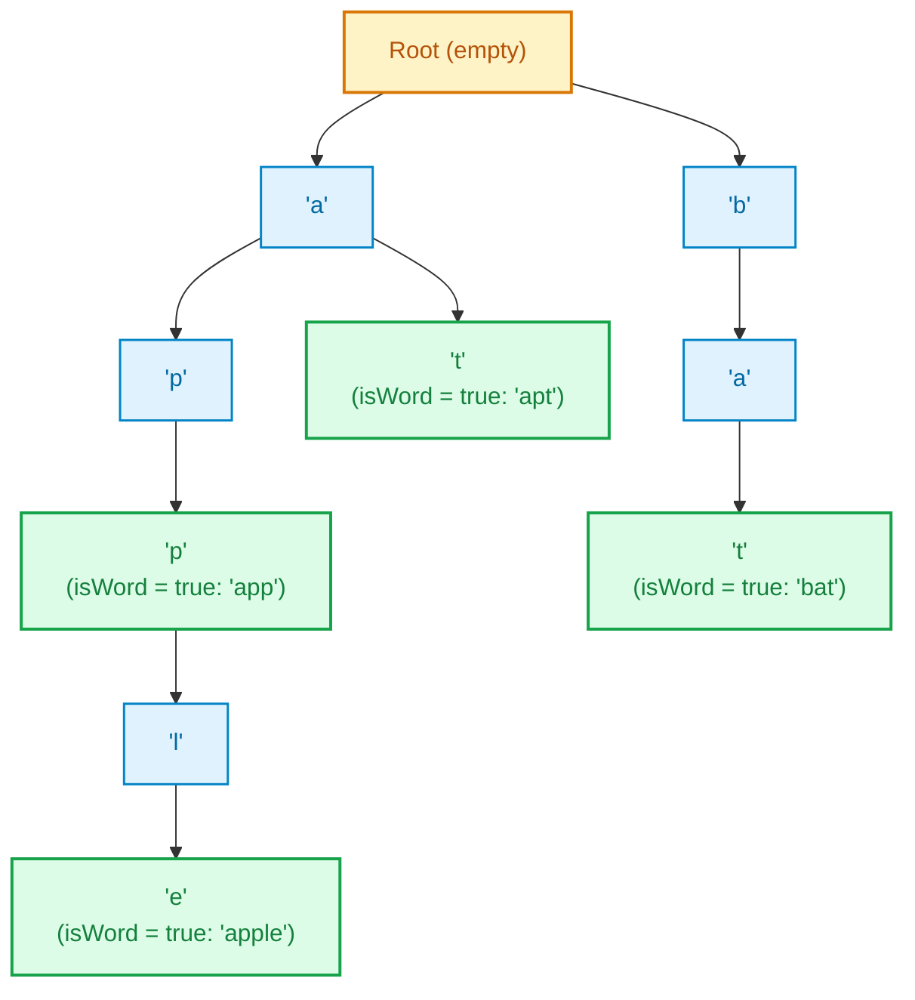

# Trie: Word Storage, Search, and Autocomplete

> **Summary:**  
> A Trie (Prefix Tree) is a tree-based data structure used to store and retrieve strings efficiently.  
> Using dynamic character child mappings, it supports $\mathcal{O}(L)$ word insertion, exact search, prefix matching, and autocomplete.

---

## 1. Definition

A **Trie** is a multi-way tree structure where each node represents a character of a prefix.  
Instead of storing entire words in separate array cells, words sharing common prefixes branch from identical parent nodes.

* **Root Node:** The root represents the empty string `""` and does not contain a character.
* **Edges:** Each edge corresponds to a character transition.
* **Terminal Flag (`isWord`):** A boolean variable at each node indicating whether the path from the root to that node represents a complete, valid word.



---

## 2. Procedure

All code examples refer to [`algorithms/strings/Trie.java`](file:///Users/manthan/Desktop/DSA3/algorithms/strings/Trie.java).

### 1. `insert(word)`:
1. Start at the `root` node.
2. For each character $c$ in `word`:
   * If `current.children` does not contain $c$, instantiate a new `Node()`.
   * Move `current` to the child node corresponding to $c$.
3. When the string finishes, set `current.isWord = true`.

### 2. `search(word)`:
1. Traverse down the character path from `root`.
2. If any character is missing in `children`, return `false`.
3. After matching all characters, return `current.isWord`.

### 3. `startsWith(prefix)`:
1. Traverse characters of `prefix`.
2. If the entire path exists, return `true` immediately (regardless of whether `isWord` is true or false).

### 4. `delete(word)`:
1. Recursively locate the terminal node of `word` and set `isWord = false`.
2. On backtracking, remove nodes that have no other children and are not marked as words themselves to reclaim memory.

---

## 3. Step-by-Step Code and Description

### Dynamic Node Definition
Using `Map<Character, Node>` supports any arbitrary Unicode characters, spaces, and numbers:

```java
static class Node {
    Map<Character, Node> children = new HashMap<>();
    boolean isWord;
}
private final Node root = new Node();
```

---

### Insertion Logic

```java
public void insert(String word) {
    if (word == null) return;
    Node current = root;

    for (int i = 0; i < word.length(); i++) {
        char ch = word.charAt(i);
        current.children.putIfAbsent(ch, new Node());
        current = current.children.get(ch);
    }
    current.isWord = true;
}
```

---

## 4. Execution Trace

Inserting: `"apple"`, `"app"`, `"apt"`, `"bat"`:

| Operation | Input | Matched / Created Nodes | Node State at End | Output |
| :--- | :---: | :--- | :--- | :---: |
| `insert("apple")` | `"apple"` | Creates `a -> p -> p -> l -> e` | `e.isWord = true` | — |
| `insert("app")` | `"app"` | Reuses `a -> p -> p` | Second `p.isWord = true` | — |
| `search("app")` | `"app"` | Traverses `a -> p -> p` | Checked: `p.isWord == true` | `true` |
| `search("appl")` | `"appl"` | Traverses `a -> p -> p -> l` | Checked: `l.isWord == false` | `false` |
| `startsWith("ap")`| `"ap"` | Traverses `a -> p` | Path exists | `true` |
| `delete("app")` | `"app"` | Unmarks second `p.isWord` | `p.children` still holds `'l'` | `true` |

---

## 5. Technical Complexity

| Operation | Time Complexity | Space Complexity | Technical Reason |
| :--- | :--- | :--- | :--- |
| **Insert** | $\mathcal{O}(L)$ | $\mathcal{O}(L)$ | Traverses $L$ characters; adds at most $L$ new nodes. |
| **Search** | $\mathcal{O}(L)$ | $\mathcal{O}(1)$ | Traverses at most $L$ pointers without additional allocations. |
| **Prefix Match** | $\mathcal{O}(L)$ | $\mathcal{O}(1)$ | Stops as soon as the prefix path matches or breaks. |
| **Delete** | $\mathcal{O}(L)$ | $\mathcal{O}(L)$ | Recursive call stack depth equals word length $L$. |

*(where $L$ is the length of the string).*
