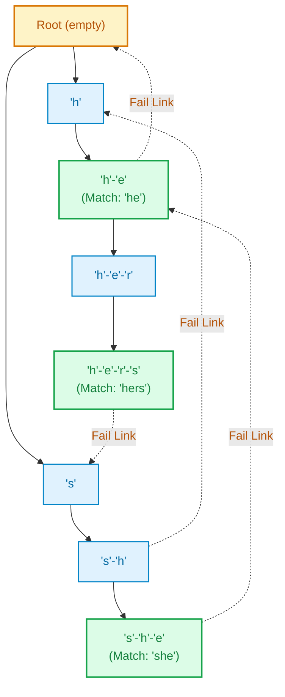
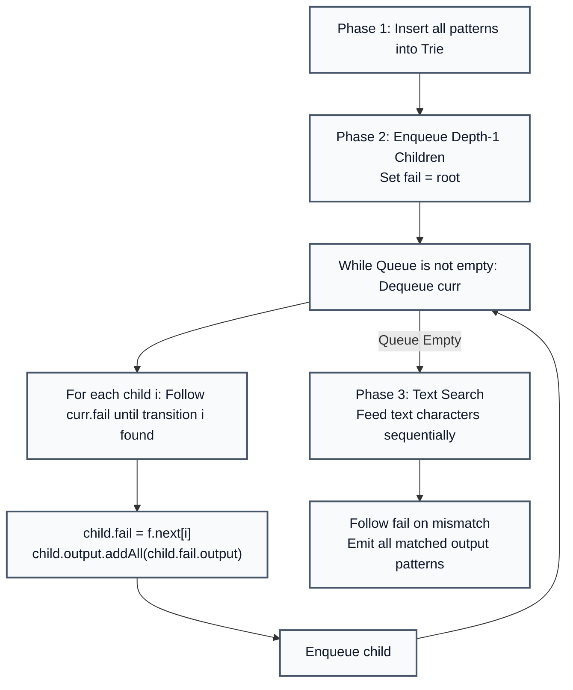

# Aho-Corasick Algorithm: Multi-Pattern Matching with Failure Links

> **Summary:**  
> The Aho-Corasick algorithm searches an arbitrary collection of keywords simultaneously within an input text in linear time.  
> It constructs a finite state automaton from a Trie augmented with BFS failure links, behaving like Knuth-Morris-Pratt (KMP) generalized to multiple patterns.

---

## 1. Definition

Given a dictionary of keywords $P = \{p_1, p_2, \dots, p_K\}$ and an input text $T$ of length $N$, the **Aho-Corasick Automaton** finds all occurrences of all keywords in a single sequential scan of $T$.

* **Trie Structure:** Represents the prefix tree of all patterns.
* **Failure Link (`fail`):** For any node representing string $u$, its `fail` link points to the node representing the longest proper suffix of $u$ that is present in the Trie.
* **Output List (`output`):** Stores all pattern strings that terminate at the current node or at any node reachable through its failure path.



---

## 2. Procedure

All code examples refer to [`algorithms/strings/AhoCorasick.java`](file:///Users/manthan/Desktop/DSA3/algorithms/strings/AhoCorasick.java).

The algorithm runs in three phases:

### Phase 1: Trie Construction
Insert each pattern into the Trie and append the pattern string to the terminal node's `output` list.

### Phase 2: Failure Link Construction (BFS)
1. Initialize a queue.
2. All immediate child nodes of the `root` (depth 1) have their `fail` pointer set to `root` and are enqueued.
3. While the queue is not empty:
   * Dequeue node `curr`.
   * For each existing child `curr.next[i]`:
     * Set $f = \text{curr.fail}$.
     * While $f \ne \text{null}$ and $f\text{.next}[i] == \text{null}$, set $f = f\text{.fail}$.
     * If a transition exists, set $\text{child.fail} = f\text{.next}[i]$; otherwise, set $\text{child.fail} = \text{root}$.
     * Merge the output matches: `child.output.addAll(child.fail.output)`.
     * Enqueue `child`.

### Phase 3: Text Search
1. Start at `curr = root`.
2. For each character $c$ in the text:
   * While `curr != null` and no transition on $c$ exists, follow `curr = curr.fail`.
   * Advance `curr = (curr != null) ? curr.next[c] : root`.
   * If `curr.output` is not empty, report all matches found ending at the current text index.



---

## 3. Step-by-Step Code and Description

```java
static class Node {
    Node[] next = new Node[26];
    Node fail;
    List<String> output = new ArrayList<>();
}
```

### BFS Failure Link Construction

```java
static void buildFailLinks() {
    Queue<Node> queue = new LinkedList<>();

    for (int i = 0; i < 26; i++) {
        if (root.next[i] != null) {
            root.next[i].fail = root;
            queue.add(root.next[i]);
        }
    }

    while (!queue.isEmpty()) {
        Node curr = queue.poll();

        for (int i = 0; i < 26; i++) {
            Node child = curr.next[i];
            if (child != null) {
                Node f = curr.fail;
                while (f != null && f.next[i] == null) {
                    f = f.fail;
                }
                child.fail = (f != null) ? f.next[i] : root;
                child.output.addAll(child.fail.output);
                queue.add(child);
            }
        }
    }
}
```

---

## 4. Execution Trace

For dictionary patterns: `["he", "she", "his", "hers"]`  
Searching text: `"ushers"`

| Step / Index | Char | Active Node Path | Fail Transition Used | Matches Emitted |
| :---: | :---: | :--- | :---: | :--- |
| **0** | `'u'` | `root` (no match) | None | None |
| **1** | `'s'` | `s` | None | None |
| **2** | `'h'` | `s -> h` | None | None |
| **3** | `'e'` | `s -> h -> e` | None | `"she"` (indices 1..3) & `"he"` (indices 2..3 via `fail`) |
| **4** | `'r'` | `fail` to `h -> e -> r` | Yes (from `she` to `he -> r`) | None |
| **5** | `'s'` | `h -> e -> r -> s` | None | `"hers"` (indices 2..5) |

---

## 5. Technical Complexity

| Parameter | Value | Technical Reason |
| :--- | :--- | :--- |
| **Trie Build Time** | $\mathcal{O}(\sum |p_i|)$ | Each character of each pattern is inserted once. |
| **Fail Link Build Time** | $\mathcal{O}(\Sigma \cdot \sum |p_i|)$ | BFS visits every node and checks transition alphabet $\Sigma = 26$. |
| **Text Search Time** | $\mathcal{O}(N + M_{\text{total}})$ | Linear in text length $N$ plus total number of reported occurrences $M_{\text{total}}$. |
| **Space Complexity** | $\mathcal{O}(\Sigma \cdot \sum |p_i|)$ | Storage for trie node transitions and failure pointers. |

---

## 6. Technical Questions and Answers

* **Question: How does Aho-Corasick relate to KMP?**  
  **Answer:** KMP constructs a failure table for a single pattern. Aho-Corasick is the generalization of KMP across an entire Trie of multiple patterns.

* **Question: Where is Aho-Corasick used in production systems?**  
  **Answer:** Intrusion detection systems (Snort), antivirus scanners (ClamAV) searching for signatures, and search engine dictionary filtering.
