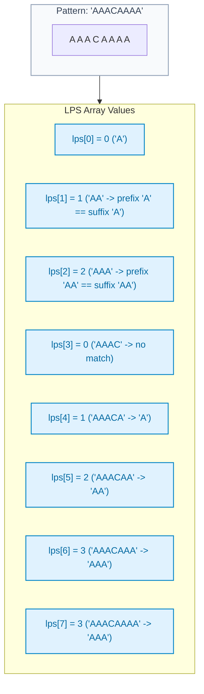
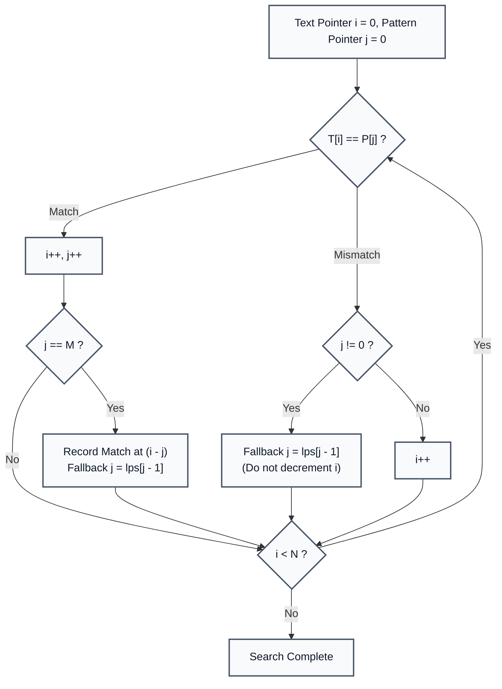

# Knuth-Morris-Pratt (KMP) Algorithm & LPS Array Construction

> **Summary:**  
> The Knuth-Morris-Pratt (KMP) algorithm finds all occurrences of a pattern in a text without backtracking the text index.  
> It precomputes a Longest Proper Prefix which is also Suffix (LPS) array in linear time $\mathcal{O}(M)$, enabling overall $\mathcal{O}(N + M)$ search complexity.

---

## 1. Definition

Given a text $T$ of length $N$ and a pattern $P$ of length $M$, the **KMP Algorithm** searches for $P$ within $T$.

* **The Problem with Naive Matching:** When a mismatch occurs after matching $k$ characters, a naive algorithm shifts the pattern by $1$ and re-examines characters from the beginning, resulting in $\mathcal{O}(N \cdot M)$ worst-case time (e.g. searching `"AAAAB"` in `"AAAAAAA..."`).
* **The KMP Solution:** When a mismatch occurs at $P[j]$, we already know the preceding characters $P[0 \dots j-1]$ matched the text. The **LPS Array** tells us the longest prefix that can align with the matched suffix, allowing the pattern to skip redundant comparisons.
* **LPS Definition:** For pattern $P$, `lps[i]` is the length of the longest proper prefix of $P[0 \dots i]$ that is also a suffix of $P[0 \dots i]$. (A "proper prefix" is a prefix that is not the entire string).



---

## 2. Procedure

All code examples refer to [`algorithms/strings/LPSDemo.java`](file:///Users/manthan/Desktop/DSA3/algorithms/strings/LPSDemo.java) and [`algorithms/strings/KMPSearch.java`](file:///Users/manthan/Desktop/DSA3/algorithms/strings/KMPSearch.java).

### Part 1: Precomputing the LPS Array
1. Set `lps[0] = 0`, `len = 0`, and `i = 1`.
2. While $i < M$:
   * If $P[i] == P[\text{len}]$: increment `len++`, set `lps[i] = len`, and increment `i++`.
   * If mismatch ($P[i] \ne P[\text{len}]$):
     * If $\text{len} \ne 0$: fallback $\text{len} = \text{lps}[\text{len} - 1]$ (do not increment $i$).
     * If $\text{len} == 0$: set `lps[i] = 0`, and increment `i++`.

### Part 2: Searching the Text
1. Initialize text pointer $i = 0$ and pattern pointer $j = 0$.
2. While $i < N$:
   * If $T[i] == P[j]$: increment both $i++$ and $j++$.
   * If $j == M$ (full match): record match at starting index $i - j$, and set $j = \text{lps}[j - 1]$.
   * If mismatch ($T[i] \ne P[j]$):
     * If $j \ne 0$: fallback $j = \text{lps}[j - 1]$ (text pointer $i$ never retreats).
     * If $j == 0$: increment $i++$.



---

## 3. Step-by-Step Code and Description

```java
static int[] buildLPS(String pattern) {
    int m = pattern.length();
    int[] lps = new int[m];
    int len = 0;
    int i = 1;

    while (i < m) {
        if (pattern.charAt(i) == pattern.charAt(len)) {
            len++;
            lps[i] = len;
            i++;
        } else {
            if (len != 0) {
                len = lps[len - 1]; // Fallback to previous longest prefix suffix
            } else {
                lps[i] = 0;
                i++;
            }
        }
    }
    return lps;
}
```

---

## 4. Execution Trace

Searching `pattern = "ABABCABAB"` in `text = "ABABDABACDABABCABAB"`:

1. Matching proceeds through $j = 0, 1, 2, 3$ (`"ABAB"`).
2. At $i = 4$, $T[4] = \text{'D'}$ while $P[4] = \text{'C'}$. Mismatch!
3. Fallback: Since $j = 4$, `lps[3] = 2` (prefix `"AB"`).  
   $\to$ Set $j = 2$. Text pointer $i = 4$ remains unchanged!
4. Compare $T[4] = \text{'D'}$ with $P[2] = \text{'A'}$. Mismatch!
5. Fallback: `lps[1] = 0` $\to$ Set $j = 0$.
6. Compare $T[4] = \text{'D'}$ with $P[0] = \text{'A'}$. Mismatch with $j = 0 \to i++$ ($i=5$).
7. Search continues forward linearly without ever backtracking in the text string.
8. **Match Found:** At starting index $10$ (`"ABABCABAB"`).

---

## 5. Technical Complexity

| Parameter | Value | Technical Reason |
| :--- | :--- | :--- |
| **Preprocessing Time** | $\mathcal{O}(M)$ | Building the LPS array requires examining each pattern character at most twice. |
| **Search Time** | $\mathcal{O}(N)$ | Text pointer $i$ strictly increases from $0$ to $N$. Pattern pointer $j$ backtracks at most $N$ times. |
| **Total Time Complexity** | $\mathcal{O}(N + M)$ | Linear in the combined lengths of text and pattern. |
| **Space Complexity** | $\mathcal{O}(M)$ | Requires an integer array of size $M$ for the LPS table. |

---

## 6. Technical Questions and Answers

* **Question: Why is text backtracking avoided in KMP?**  
  **Answer:** In naive matching, $i$ resets backward after a mismatch. KMP guarantees that text pointer $i$ never decrements because the LPS table tells us the exact shift offset where the next possible match can begin.

* **Question: What happens if `lps[len - 1]` is used on mismatch?**  
  **Answer:** It jumps to the next shorter candidate prefix that could match the suffix up to the mismatch point, identical to dynamic programming state transitions.
