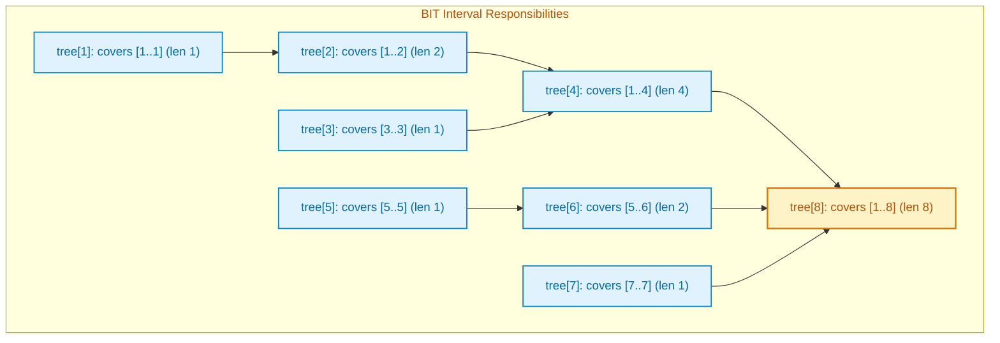

# Binary Indexed Tree (BIT / Fenwick Tree)

> **Summary:**  
> A Binary Indexed Tree (BIT), also called a Fenwick Tree, is an array-based data structure used for prefix and range sum queries.  
> It supports both point updates and prefix sum queries in logarithmic time $\mathcal{O}(\log N)$ using bitwise Lowest Significant Bit (LSB) operations.

---

## 1. Definition

Given an array of $N$ values, we often need to support two operations repeatedly:
1. **Range Sum Query:** Calculate the sum of elements from index $L$ to $R$.
2. **Point Update:** Add a value $\Delta$ to an element at index $i$.

### Limitations of Traditional Approaches
* **Standard Array:** Point updates are $\mathcal{O}(1)$, but computing a range sum takes $\mathcal{O}(N)$ linear time.
* **Prefix Sum Array:** Range sum queries are $\mathcal{O}(1)$, but updating an element requires updating all subsequent prefix sums, taking $\mathcal{O}(N)$ time.
* **Segment Tree:** Solves both in $\mathcal{O}(\log N)$, but requires $\mathcal{O}(4N)$ memory and complex recursive pointer traversal.

### The Binary Indexed Tree (BIT) Solution
A Binary Indexed Tree stores partial prefix sums in an array of size $N + 1$ (using 1-based indexing).  
Each index $i$ stores the sum of elements in the half-open interval $(i - \text{LSB}(i), i]$, where $\text{LSB}(i) = i \ \& \ (-i)$ is the Lowest Significant Set Bit of $i$.



---

## 2. Procedure and The Bitwise LSB Mechanism

All code examples refer to [`algorithms/trees/BinaryIndexedTree.java`](file:///Users/manthan/Desktop/DSA3/algorithms/trees/BinaryIndexedTree.java).

### The LowBit (LSB) Operation: `i & (-i)`
In two's complement binary representation, negative numbers invert all bits and add $1$.  
The bitwise AND operation `i & (-i)` isolates the lowest bit of $i$ that is set to $1$:
* For $i = 6$ (binary `00110`), $-6$ is binary `11010`.  
  $6 \ \& \ (-6) = \text{binary } 00010 = 2$.  
  Therefore, index 6 stores the sum of a range of length $2$ (indices $5$ and $6$).
* For $i = 4$ (binary `00100`), $-4$ is binary `11100`.  
  $4 \ \& \ (-4) = \text{binary } 00100 = 4$.  
  Therefore, index 4 stores the sum of a range of length $4$ (indices $1$ to $4$).

### 1. Point Update (`update(i, delta)`)
To add value `delta` to index `i`, we must update all nodes whose intervals cover index `i`:
1. Add `delta` to `tree[i]`.
2. Move upward to the next covering parent by adding the LSB:
   $$i = i + (i \ \& \ -i)$$
3. Repeat until $i > N$.

### 2. Prefix Sum Query (`queryPrefix(i)`)
To compute the sum from index $1$ to `i`:
1. Accumulate `sum += tree[i]`.
2. Move downward to the preceding disjoint interval by stripping the LSB:
   $$i = i - (i \ \& \ -i)$$
3. Repeat until $i = 0$.

### 3. Range Sum Query (`queryRange(L, R)`)
Using the principle of inclusion-exclusion:
$$\text{sum}[L \dots R] = \text{queryPrefix}(R) - \text{queryPrefix}(L - 1)$$

```mermaid
flowchart LR
    subgraph UpdateFlow ["Update(i, delta): Walk Upward"]
        U1["Index i"] -->|i += (i & -i)| U2["Parent Node"] -->|i += (i & -i)| U3["Ancestor Node"]
    end

    subgraph QueryFlow ["QueryPrefix(i): Walk Downward"]
        Q1["Index i"] -->|i -= (i & -i)| Q2["Preceding Range"] -->|i -= (i & -i)| Q3["Index 0 (Stop)"]
    end

    classDef up fill:#dcfce7,stroke:#16a34a,stroke-width:2px,color:#15803d;
    classDef down fill:#e0f2fe,stroke:#0284c7,stroke-width:2px,color:#0369a1;
    class U1,U2,U3 up;
    class Q1,Q2,Q3 down;
```

---

## 3. Step-by-Step Code and Description

### Data Structure Initialization (1-Based Indexing)

```java
public class BinaryIndexedTree {
    private final int[] tree;
    private final int n;

    public BinaryIndexedTree(int n) {
        this.n = n;
        this.tree = new int[n + 1]; // Size n + 1 for 1-based indexing
    }
}
```

---

### Update and Query Implementations

```java
// Point Update: Add delta to element at 1-based index i
public void update(int i, int delta) {
    while (i <= n) {
        tree[i] += delta;
        i += (i & -i); // Move upward to responsible parent
    }
}

// Prefix Sum: Compute sum from index 1 to i
public int queryPrefix(int i) {
    int sum = 0;
    while (i > 0) {
        sum += tree[i];
        i -= (i & -i); // Move downward to predecessor interval
    }
    return sum;
}

// Range Sum: Compute sum from L to R
public int queryRange(int l, int r) {
    if (l > r) return 0;
    return queryPrefix(r) - queryPrefix(l - 1);
}
```

---

## 4. Execution Trace

For array values: `[3, 2, -1, 6, 5, 4, -3, 3, 7, 2]` ($N = 10$):

### Prefix Query for $i = 7$:
1. $i = 7$ (binary `0111`): add `tree[7]` (value: $-3$).  
   $7 - (7 \ \& \ -7) = 7 - 1 = 6$.
2. $i = 6$ (binary `0110`): add `tree[6]` (covers $5..6$, sum: $5 + 4 = 9$).  
   $6 - (6 \ \& \ -6) = 6 - 2 = 4$.
3. $i = 4$ (binary `0100`): add `tree[4]` (covers $1..4$, sum: $3 + 2 - 1 + 6 = 10$).  
   $4 - (4 \ \& \ -4) = 4 - 4 = 0$ (Stop).
4. **Total Prefix Sum:** $(-3) + 9 + 10 = \mathbf{16}$.  
   Direct check: $3 + 2 - 1 + 6 + 5 + 4 - 3 = 16$ ($\checkmark$).

### Point Update: Add $+5$ to index 4:
1. $i = 4$ (binary `0100`): `tree[4] += 5`.  
   $4 + (4 \ \& \ -4) = 4 + 4 = 8$.
2. $i = 8$ (binary `1000`): `tree[8] += 5`.  
   $8 + (8 \ \& \ -8) = 8 + 8 = 16$ (Exceeds $N=10$, Stop).
3. Exactly two tree slots are updated in logarithmic time $\mathcal{O}(\log N)$.

---

## 5. Technical Complexity

| Parameter | Value | Technical Reason |
| :--- | :--- | :--- |
| **Point Update Time** | $\mathcal{O}(\log N)$ | Adds LSB at each step. An integer $\le N$ has at most $\lceil \log_2 N \rceil$ set bits. |
| **Prefix Query Time** | $\mathcal{O}(\log N)$ | Subtracts LSB at each step. At most $\lceil \log_2 N \rceil$ hops to reach $0$. |
| **Range Query Time** | $\mathcal{O}(\log N)$ | Two prefix queries executed in sequence: $\mathcal{O}(\log N) + \mathcal{O}(\log N) = \mathcal{O}(\log N)$. |
| **Space Complexity** | $\mathcal{O}(N)$ | Requires an array of exactly $N + 1$ integers (compared to $4N$ for Segment Trees). |
