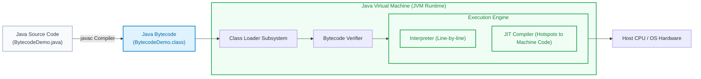
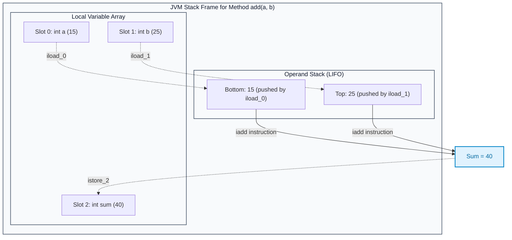

# Java Bytecode: Execution Model and JVM Architecture

> **Summary:**  
> Java Bytecode is the platform-independent intermediate representation produced by the Java compiler (`javac`).  
> It is executed by the Java Virtual Machine (JVM) using a stack-based execution architecture, enabling the "Write Once, Run Anywhere" (WORA) model.

---

## 1. Definition

When high-level Java source code (`.java`) is compiled, it does not convert directly into processor-specific machine instructions. Instead, it compiles into **Java Bytecode** stored in a `.class` binary file.

* **Bytecode Instructions:** Each bytecode instruction consists of a 1-byte opcode (such as `iload`, `iadd`, `istore`, `invokevirtual`) followed by zero or more parameters.
* **The Stack-Based Model:** Unlike x86 or ARM architectures that operate primarily on physical registers, the JVM operates on an **Operand Stack**. Operations pop operands from the stack, compute results in the ALU, and push the result back onto the stack.
* **Platform Independence:** The exact same `.class` file runs unmodified on Windows, macOS, Linux, and embedded systems, provided a host-specific JVM is installed.



---

## 2. Structure of the `.class` File and Runtime Stack

A compiled Java bytecode file follows a strict binary format:
1. **Magic Number (`0xCAFEBABE`):** First 4 bytes verifying the file as a valid Java class file.
2. **Version Numbers:** Minor and major JVM version specifications.
3. **Constant Pool:** Symbol table containing string literals, class names, method signatures, and field references.
4. **Method Code Attributes:**
   * **`max_stack`:** Maximum depth of the operand stack required by the method.
   * **`max_locals`:** Total slots reserved in the Local Variable Array.
   * **Bytecode Array:** The sequence of opcodes.



---

## 3. Step-by-Step Code and Disassembled Bytecode

All code examples refer to [`algorithms/bytecode/BytecodeDemo.java`](file:///Users/manthan/Desktop/DSA3/algorithms/bytecode/BytecodeDemo.java).

Disassembly produced using `javap -c algorithms.bytecode.BytecodeDemo`:

### Part 1: Arithmetic Addition Method

```java
public static int add(int a, int b) {
    int sum = a + b;
    return sum;
}
```

**Corresponding Bytecode Instructions:**
```
public static int add(int, int);
  Code:
     0: iload_0          // Push local variable 0 ('a') onto operand stack
     1: iload_1          // Push local variable 1 ('b') onto operand stack
     2: iadd             // Pop both integers, sum them, push result (40)
     3: istore_2         // Pop result from stack and store into local variable 2 ('sum')
     4: iload_2          // Push local variable 2 onto stack
     5: ireturn          // Return integer value from top of stack
```

---

### Part 2: Branching and Conditional Evaluation

```java
public static int max(int a, int b) {
    if (a > b) {
        return a;
    } else {
        return b;
    }
}
```

**Corresponding Bytecode Instructions:**
```
public static int max(int, int);
  Code:
     0: iload_0          // Push 'a'
     1: iload_1          // Push 'b'
     2: if_icmple     7  // If a <= b, jump to instruction 7 (else branch)
     5: iload_0          // True branch: push 'a'
     6: ireturn          // Return 'a'
     7: iload_1          // False branch: push 'b'
     8: ireturn          // Return 'b'
```

---

### Part 3: Loop Execution and Backwards Jump

```java
public static int computeSumUpTo(int n) {
    int total = 0;
    for (int i = 1; i <= n; i++) {
        total += i;
    }
    return total;
}
```

**Corresponding Bytecode Instructions:**
```
public static int computeSumUpTo(int);
  Code:
     0: iconst_0         // Push constant 0
     1: istore_1         // total = 0 (stored in local var 1)
     2: iconst_1         // Push constant 1
     3: istore_2         // i = 1 (stored in local var 2)
     4: iload_2          // Loop start: push i
     5: iload_0          // Push n
     6: if_icmpgt     19 // If i > n, exit loop to instruction 19
     9: iload_1          // Push total
    10: iload_2          // Push i
    11: iadd             // total + i
    12: istore_1         // total = total + i
    13: iinc          2, 1 // Increment i by 1 directly in local variable array
    16: goto          4  // Unconditional branch back to loop condition (instruction 4)
    19: iload_1          // Loop end: push total
    20: ireturn          // Return total
```

---

## 4. Execution Trace: Operand Stack States for `add(15, 25)`

Tracing the JVM stack and local variables step-by-step:

| Bytecode Offset | Instruction Executed | Operand Stack State | Local Variables `[0, 1, 2]` | Description |
| :---: | :--- | :--- | :---: | :--- |
| **0** | `iload_0` | `[15]` | `[15, 25, empty]` | Reads parameter `a` into stack |
| **1** | `iload_1` | `[15, 25]` | `[15, 25, empty]` | Reads parameter `b` into stack |
| **2** | `iadd` | `[40]` | `[15, 25, empty]` | Pops 15 & 25, computes $15 + 25 = 40$, pushes 40 |
| **3** | `istore_2` | `[]` (empty) | `[15, 25, 40]` | Stores 40 into variable `sum` |
| **4** | `iload_2` | `[40]` | `[15, 25, 40]` | Prepares return value on stack |
| **5** | `ireturn` | `[]` (empty) | `[15, 25, 40]` | Returns integer 40 to caller frame |

---

## 5. Technical Complexity & Performance Comparison

| Aspect | Java Bytecode (JVM) | Native Machine Code (C/C++) | Technical Advantage |
| :--- | :--- | :--- | :--- |
| **Portability** | Universal (`.class` runs everywhere) | Architecture-specific (recompiled per OS/CPU) | High: WORA philosophy. |
| **Execution Model** | Stack-based (Operand Stack) | Register-based (Hardware CPU registers) | Simple instruction set; compact binary size. |
| **Safety & Security** | Verified at load-time by Bytecode Verifier | Unchecked pointer arithmetic | Prevents stack overflows and memory corruption. |
| **Runtime Optimization** | JIT compiles hot bytecode methods to assembly | Ahead-of-time (AOT) optimized | Adaptive optimization based on live profiling. |
