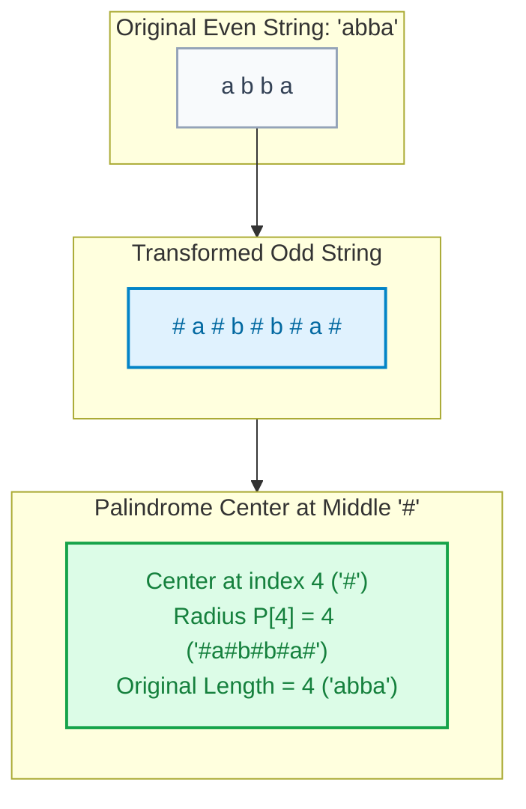
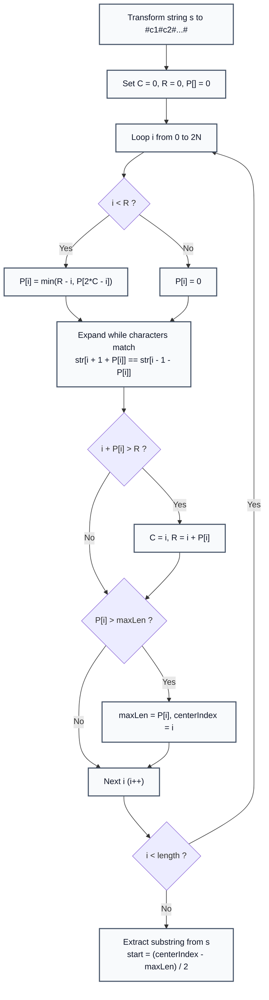

# Manacher's Algorithm: Linear-Time Palindromic Substring

> **Summary:**  
> Manacher's Algorithm finds the longest palindromic substring in a string in strictly linear time $\mathcal{O}(N)$.  
> It inserts delimiter characters to unify odd and even-length palindromes, and uses previously computed palindrome symmetries to avoid redundant character expansions.

---

## 1. Definition

A **Palindrome** is a string that reads the same forwards and backwards.  
The **Longest Palindromic Substring (LPS)** problem asks for the substring of maximal length that is a palindrome.

* **The Parity Problem:** Palindromes can have odd length (centered at a character, e.g., `"aba"`) or even length (centered between two characters, e.g., `"abba"`).
* **The Manacher Transformation:** By inserting sentinel character `#` between each character and at both ends, any string of length $N$ becomes a string of length $2N + 1$:
  $$\text{"aba"} \to \text{"\#a\#b\#a\#"} \quad (\text{Length: } 7)$$
  $$\text{"abba"} \to \text{"\#a\#b\#b\#a\#"} \quad (\text{Length: } 9)$$
  Every palindrome in the transformed string now has an **odd length centered at an exact single character**.
* **Radius Array $P[i]$:** $P[i]$ stores the radius of the longest palindrome centered at index $i$. The length of the palindrome in the original string equals $P[i]$.



---

## 2. Procedure and Symmetry Exploitation

All code examples refer to [`algorithms/strings/Manacher.java`](file:///Users/manthan/Desktop/DSA3/algorithms/strings/Manacher.java).

The algorithm maintains:
* $C$: Center of the palindrome that extends furthest to the right.
* $R$: Right boundary of this palindrome ($R = C + P[C]$).

For any new position $i$:
1. **Find Mirror:** The mirror of index $i$ with respect to center $C$ is:
   $$i_{\text{mirror}} = 2C - i$$
2. **Re-use Symmetry:** If $i < R$, the palindrome at $i$ is initially at least as large as the mirror's palindrome, bounded by $R - i$:
   $$P[i] = \min(R - i, P[i_{\text{mirror}}])$$
3. **Expand Beyond Boundary:** Try to expand beyond the known radius $P[i]$ by comparing characters to the left and right.
4. **Update Center & Boundary:** If the newly expanded palindrome exceeds boundary $R$, update $C = i$ and $R = i + P[i]$.
5. **Track Maximum:** Maintain the maximum value of $P[i]$ and its center index to extract the longest palindromic substring at the end.



---

## 3. Step-by-Step Code and Description

```java
public class Manacher {

    static String longestPalindrome(String s) {
        if (s == null || s.length() == 0) return "";

        // 1. Insert '#' delimiters
        StringBuilder sb = new StringBuilder("#");
        for (int i = 0; i < s.length(); i++) {
            sb.append(s.charAt(i)).append('#');
        }
        String str = sb.toString();
        int n = str.length();

        int[] p = new int[n];
        int c = 0; // Center of current rightmost palindrome
        int r = 0; // Right boundary

        int maxLen = 0;
        int centerIndex = 0;

        for (int i = 0; i < n; i++) {
            int iMirror = 2 * c - i;

            // 2. Exploit symmetry within current boundary
            if (r > i) {
                p[i] = Math.min(r - i, p[iMirror]);
            } else {
                p[i] = 0;
            }

            // 3. Attempt character expansion
            while (i - 1 - p[i] >= 0 && i + 1 + p[i] < n &&
                   str.charAt(i + 1 + p[i]) == str.charAt(i - 1 - p[i])) {
                p[i]++;
            }

            // 4. Update rightmost boundary
            if (i + p[i] > r) {
                c = i;
                r = i + p[i];
            }

            // 5. Track maximum palindrome length
            if (p[i] > maxLen) {
                maxLen = p[i];
                centerIndex = i;
            }
        }

        // 6. Map back to original string coordinates
        int start = (centerIndex - maxLen) / 2;
        return s.substring(start, start + maxLen);
    }
}
```

---

## 4. Execution Trace

Testing `"babad"`:
* Transformed string: `"#b#a#b#a#d#"` (Length: $11$)

| Transformed Index $i$ | Transformed Char | Computed Radius $P[i]$ | Palindromic Substring in Transformed String | Original Substring | Original Length |
| :---: | :---: | :---: | :--- | :---: | :---: |
| **0** | `'#'` | `0` | `"#"` | `""` | 0 |
| **1** | `'b'` | `1` | `"#b#"` | `"b"` | 1 |
| **2** | `'#'` | `0` | `"#"` | `""` | 0 |
| **3** | `'a'` | `3` | `"#b#a#b#"` | `"bab"` | 3 |
| **4** | `'#'` | `0` | `"#"` | `""` | 0 |
| **5** | `'b'` | `3` | `"#a#b#a#"` | `"aba"` | 3 |
| **6** | `'#'` | `0` | `"#"` | `""` | 0 |
| **7** | `'a'` | `1` | `"#a#"` | `"a"` | 1 |
| **8** | `'#'` | `0` | `"#"` | `""` | 0 |
| **9** | `'d'` | `1` | `"#d#"` | `"d"` | 1 |
| **10** | `'#'` | `0` | `"#"` | `""` | 0 |

**Maximum Radius Found:** $P[3] = 3$ centered at `'a'` $\to$ `"bab"`. (Or $P[5] = 3 \to$ `"aba"`).

---

## 5. Technical Complexity

| Parameter | Value | Technical Reason |
| :--- | :--- | :--- |
| **Time Complexity** | $\mathcal{O}(N)$ | The right boundary $R$ advances from $0$ to $2N + 1$ and never decrements. Character comparisons only occur when extending $R$. Total comparisons $\le 2N$. |
| **Space Complexity** | $\mathcal{O}(N)$ | The transformed string and the radius array $P[]$ require $2N + 1$ memory cells. |

---

## 6. Technical Questions and Answers

* **Question: Why do naive expand-around-center algorithms take $\mathcal{O}(N^2)$ time?**  
  **Answer:** For repetitive strings like `"aaaaaa"`, naive expansion tests all characters from every center from scratch ($\frac{N^2}{2}$ checks). Manacher eliminates re-testing by copying the mirror's known radius.

* **Question: How does `start = (centerIndex - maxLen) / 2` map back to the original string?**  
  **Answer:** In the transformed string, every original character is at an odd index $2k + 1$. Subtracting the radius `maxLen` and dividing by $2$ accounts for the interleaved `#` delimiters, returning the exact 0-based starting index in the original string.
