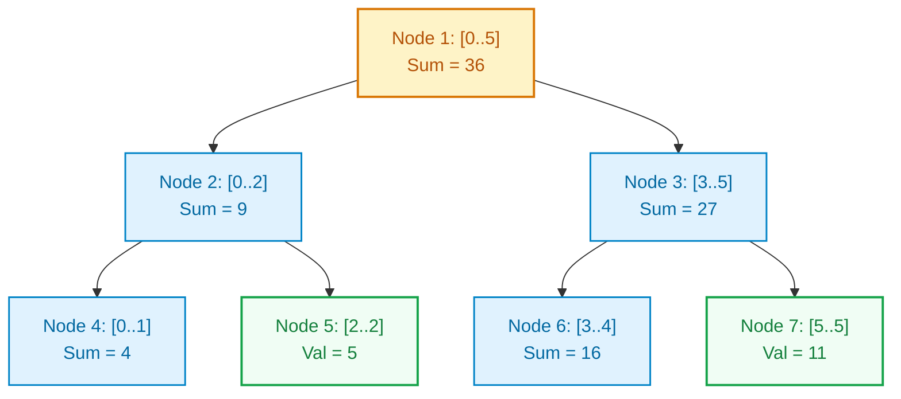
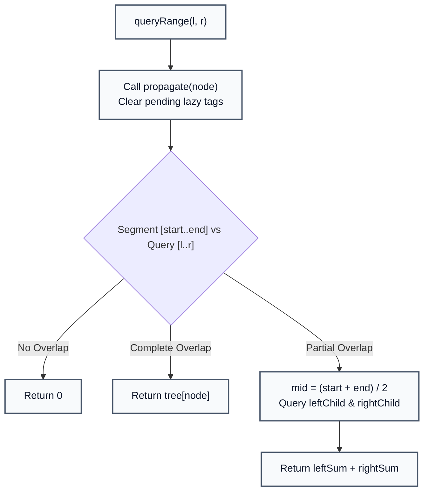

# Segment Tree with Lazy Propagation

> **Summary:**  
> A Segment Tree is a binary tree data structure used for fast interval queries and range updates.  
> Using Lazy Propagation, it answers range sum queries and applies range modifications in logarithmic time $\mathcal{O}(\log N)$.

---

## 1. Definition

Given an array of $N$ numeric values, the **Segment Tree** organizes intervals hierarchically:
* **Leaf Nodes:** Represent individual elements of the array (`tree[node] = values[index]`).
* **Internal Nodes:** Represent the merge (e.g. sum, minimum, or maximum) of their left and right children:
  $$\text{tree}[\text{node}] = \text{tree}[2 \cdot \text{node}] + \text{tree}[2 \cdot \text{node} + 1]$$
* **Lazy Propagation Array (`lazy`):** Postpones updating child nodes when an entire range update applies to a parent segment. Instead of recursively updating all descendant leaves, the update is stored in the parent's `lazy` slot and propagated downward only when that branch is accessed by a future query.



---

## 2. Procedure

All code examples refer to [`algorithms/trees/SegmentTree.java`](file:///Users/manthan/Desktop/DSA3/algorithms/trees/SegmentTree.java).

### 1. `build(node, start, end, values)`
1. If `start == end`, assign `tree[node] = values[start]`.
2. Otherwise, calculate `mid = (start + end) / 2`.
3. Recursively build `leftChild = 2 * node` and `rightChild = 2 * node + 1`.
4. Merge results: `tree[node] = tree[leftChild] + tree[rightChild]`.

### 2. `propagate(node, start, end)` (Lazy Push-Down)
1. If `lazy[node] != 0`:
   * Update the current node's value: `tree[node] += (end - start + 1) * lazy[node]`.
   * If not a leaf (`start != end`), push the lazy tag to children:
     `lazy[2 * node] += lazy[node]` and `lazy[2 * node + 1] += lazy[node]`.
   * Reset `lazy[node] = 0`.

### 3. `updateRange(node, start, end, l, r, val)`
1. Resolve pending lazy tags using `propagate()`.
2. If the segment $[start \dots end]$ is completely within $[l \dots r]$:
   * Apply update to `tree[node]`.
   * Mark children as lazy and return.
3. If partial overlap, recurse into left and right subtrees, then recalculate `tree[node]`.

### 4. `queryRange(node, start, end, l, r)`
1. Resolve pending lazy tags using `propagate()`.
2. If $[start \dots end]$ is completely outside $[l \dots r]$, return $0$.
3. If completely inside, return `tree[node]`.
4. If partial overlap, return `queryRange(left) + queryRange(right)`.



---

## 3. Step-by-Step Code and Description

### Lazy Push-Down Function

```java
private void propagate(int node, int start, int end) {
    if (lazy[node] != 0) {
        // Apply pending updates to current segment
        tree[node] += (end - start + 1) * lazy[node];

        // Propagate lazy tags to children if not leaf
        if (start != end) {
            lazy[2 * node] += lazy[node];
            lazy[2 * node + 1] += lazy[node];
        }
        lazy[node] = 0;
    }
}
```

---

## 4. Execution Trace

For array `values = [1, 3, 5, 7, 9, 11]` ($N = 6$):
* Initial `tree[1] = 1 + 3 + 5 + 7 + 9 + 11 = 36`.

| Operation | Target Range | Operation Details | Output / Tree State |
| :--- | :---: | :--- | :---: |
| `queryRange(1, 3)` | $[1 \dots 3]$ | Combines index 1 (3), index 2 (5), index 3 (7) | **`15`** |
| `queryRange(0, 5)` | $[0 \dots 5]$ | Reads root node `tree[1]` directly | **`36`** |
| `updateRange(1, 4, 10)` | $[1 \dots 4]$ | Adds $10$ to elements at indices $1, 2, 3, 4$ | Lazy tags set on sub-branches |
| `queryRange(1, 3)` | $[1 \dots 3]$ | Propagates lazy tags: $(3+10) + (5+10) + (7+10)$ | **`45`** |
| `queryRange(0, 5)` | $[0 \dots 5]$ | Root sum increases by $4 \times 10 = 40 \to 36 + 40$ | **`76`** |

---

## 5. Technical Complexity

| Parameter | Value | Technical Reason |
| :--- | :--- | :--- |
| **Tree Build Time** | $\mathcal{O}(N)$ | Builds $2N - 1$ total nodes recursively from bottom up. |
| **Range Query Time** | $\mathcal{O}(\log N)$ | At each tree level, at most 4 nodes are visited. Tree height is $\lceil \log_2 N \rceil$. |
| **Range Update Time** | $\mathcal{O}(\log N)$ | Lazy propagation prevents descending into fully covered subtrees. |
| **Space Complexity** | $\mathcal{O}(4N)$ | A 1-based binary tree over $N$ leaves requires at most $4N$ array slots. |

---

## 6. Technical Questions and Answers

* **Question: What is the difference between Online Queries and Offline Queries?**  
  **Answer:** Online queries must be answered immediately before reading the next query (e.g. when updates and queries are interleaved). Offline queries can all be collected in advance and sorted (e.g., by right boundary or using Mo's square-root decomposition algorithm) to optimize total processing time.

* **Question: Why do we allocate $4N$ space for the tree array?**  
  **Answer:** If $N$ is not an exact power of 2, the binary tree must be padded to the next power of 2 ($2^{\lceil \log_2 N \rceil + 1} \le 4N$) to prevent index out-of-bounds errors on child references $2 \cdot \text{node} + 1$.
