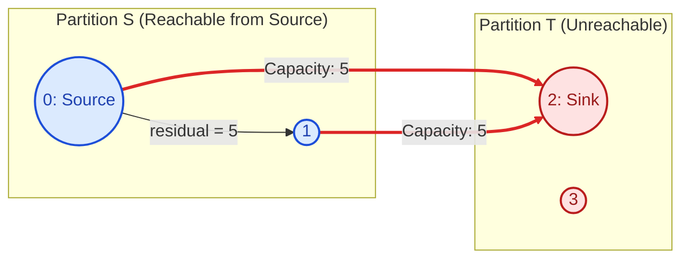
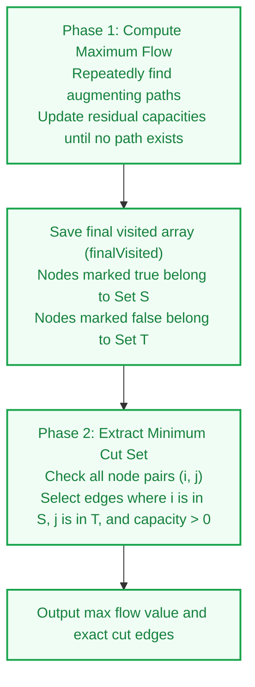

# Edmonds-Karp and Minimum Cut Algorithm

> **Summary:**  
> This algorithm computes the maximum network flow and identifies the edges of the minimum cut.  
> It proves the Max-Flow Min-Cut theorem by extracting the bottleneck cut set from the residual graph.

---

## 1. Definition

A **Cut** in a flow network is a partition of vertices into two disjoint sets:
* **Set $S$:** Contains the source node ($s \in S$).
* **Set $T$:** Contains the sink node ($t \in T$).

The **capacity of a cut** is the sum of the original capacities of all edges that point from Set $S$ to Set $T$:

$$C(S, T) = \sum_{u \in S, v \in T} \text{capacity}[u][v]$$

### The Max-Flow Min-Cut Theorem
The maximum flow from source to sink equals the capacity of the minimum cut:

$$\text{Maximum Flow Value} = \text{Capacity of Minimum Cut}$$



---

## 2. Procedure

The algorithm executes two sequential phases:



### Identification of the Minimum Cut Set
1. When no path from source to sink exists in the residual graph, the while-loop terminates.
2. The last search defines the reachability partition:
   * **Set $S$:** Nodes visited during the final search (`finalVisited[u] == true`).
   * **Set $T$:** Nodes not visited during the final search (`finalVisited[v] == false`).
3. Any original directed edge $u \to v$ where $u \in S$, $v \in T$, and original $\text{capacity}[u][v] > 0$ is a **minimum cut edge**.

---

## 3. Step-by-Step Code and Description

All code examples refer to [`algorithms/flow/EdmondsKarp.java`](file:///Users/manthan/Desktop/DSA3/algorithms/flow/EdmondsKarp.java).

---

### Part 1: Augmentation and State Capture

The algorithm searches for augmenting paths.  
When the search returns `false`, the algorithm captures the `visited` array into `finalVisited`.

```java
int maxFlow = 0;
boolean[] finalVisited = new boolean[n];

while (true) {
    boolean[] visited = new boolean[n];
    Arrays.fill(parent, -1);

    if (!dfs(residual, source, sink, visited, parent)) {
        finalVisited = visited; // Save partition state
        break;                  // Terminate when no path remains
    }

    // Path tracing and residual capacity updates
    int pathFlow = Integer.MAX_VALUE;
    for (int v = sink; v != source; v = parent[v]) {
        int u = parent[v];
        pathFlow = Math.min(pathFlow, residual[u][v]);
    }

    for (int v = sink; v != source; v = parent[v]) {
        int u = parent[v];
        residual[u][v] -= pathFlow;
        residual[v][u] += pathFlow;
    }

    maxFlow += pathFlow;
}
```

```mermaid
sequenceDiagram
    autonumber
    participant Loop as while(true)
    participant DFS as dfs()
    participant State as finalVisited

    Loop->>DFS: Search path in residual graph
    DFS-->>Loop: Path discovered -> Augment flow
    Loop->>DFS: Search path in residual graph
    DFS-->>Loop: Return false (No path from s to t)
    Loop->>State: finalVisited = visited
    Loop->>Loop: break loop
```

---

### Part 2: Extracting Cut Edges

Iterate through all pairs of nodes $(i, j)$ in the network.  
An edge belongs to the minimum cut set if:
1. Node $i$ is reachable in the residual graph (`finalVisited[i] == true`).
2. Node $j$ is not reachable in the residual graph (`!finalVisited[j]`).
3. The original capacity between $i$ and $j$ is greater than zero (`capacity[i][j] > 0`).

```java
System.out.println("Capacity of the Minimum Cut (Max Flow): " + maxFlow);
System.out.println("Edges in the Minimum Cut set:");

for (int i = 0; i < n; i++) {
    for (int j = 0; j < n; j++) {
        if (finalVisited[i] && !finalVisited[j] && capacity[i][j] > 0) {
            System.out.println(i + " -> " + j + " (Capacity: " + capacity[i][j] + ")");
        }
    }
}
```

---

## 4. Execution Trace

The graph in [`algorithms/flow/EdmondsKarp.java`](file:///Users/manthan/Desktop/DSA3/algorithms/flow/EdmondsKarp.java#L78-L87) has 4 nodes ($0=\text{Source}, 1, 2=\text{Sink}, 3$):

```
Capacities:
0 -> 1: 10
0 -> 2: 5
1 -> 2: 5
2 -> 0: 5
3 -> 0: 10
```

### Iteration 1
1. **Augmenting Path:** $0 \to 1 \to 2$.
2. **Bottleneck:** $\min(\text{residual}[0][1], \text{residual}[1][2]) = \min(10, 5) = 5$.
3. **Residual Updates:**
   * $\text{residual}[0][1] = 10 - 5 = 5$
   * $\text{residual}[1][0] = 0 + 5 = 5$
   * $\text{residual}[1][2] = 5 - 5 = 0$
   * $\text{residual}[2][1] = 0 + 5 = 5$
4. **Current maxFlow:** $0 + 5 = 5$.

### Iteration 2
1. **Augmenting Path:** $0 \to 2$ directly.
2. **Bottleneck:** $\text{residual}[0][2] = 5$.
3. **Residual Updates:**
   * $\text{residual}[0][2] = 5 - 5 = 0$
   * $\text{residual}[2][0] = 5 + 5 = 10$
4. **Current maxFlow:** $5 + 5 = 10$.

### Iteration 3 (Termination & Cut Extraction)
1. **DFS Traversal:**
   * Start at Node 0.
   * Node 0 visits Node 1 because $\text{residual}[0][1] = 5$.
   * Node 1 has no available outgoing edges ($\text{residual}[1][2] = 0$).
   * Node 2 is not reached. DFS returns `false`.
2. **Partition Results:**
   * `finalVisited[0] = true` $\implies 0 \in S$
   * `finalVisited[1] = true` $\implies 1 \in S$
   * `finalVisited[2] = false` $\implies 2 \in T$
   * `finalVisited[3] = false` $\implies 3 \in T$
3. **Cut Set Identification:**
   * Edge $0 \to 2$: Node 0 is in $S$, Node 2 is in $T$, $\text{capacity}[0][2] = 5 > 0$.
   * Edge $1 \to 2$: Node 1 is in $S$, Node 2 is in $T$, $\text{capacity}[1][2] = 5 > 0$.
4. **Program Output:**
   ```
   Capacity of the Minimum Cut (Max Flow): 10
   Edges in the Minimum Cut set:
   0 -> 2 (Capacity: 5)
   1 -> 2 (Capacity: 5)
   ```

---

## 5. Technical Complexity

| Parameter | Value | Technical Reason |
| :--- | :--- | :--- |
| **Max Flow Computation** | $\mathcal{O}(E \cdot \text{max flow})$ | Dependent on path augmentation count in the residual graph. |
| **Cut Set Extraction** | $\mathcal{O}(V^2)$ | A nested loop evaluates all vertex pairs in the adjacency matrix. |
| **Space Complexity** | $\mathcal{O}(V^2)$ | Requires storage for capacity and residual matrices of size $V \times V$. |

---

## 6. Technical Questions and Answers

* **Question: What is a cut in a flow network?**  
  **Answer:** A cut is a division of network vertices into two sets $S$ and $T$ such that source $s \in S$ and sink $t \in T$.

* **Question: What is the capacity of a cut?**  
  **Answer:** It is the sum of capacities of all original edges directed from set $S$ to set $T$.

* **Question: What does the Max-Flow Min-Cut theorem state?**  
  **Answer:** The value of the maximum flow in a network strictly equals the capacity of the minimum cut.

* **Question: How does the algorithm find the minimum cut set?**  
  **Answer:** It identifies all edges pointing from residual-reachable nodes to residual-unreachable nodes.
