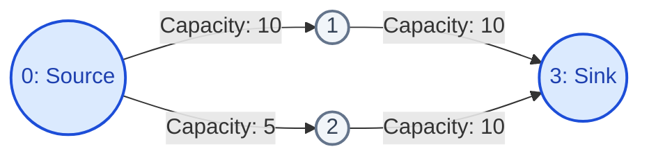
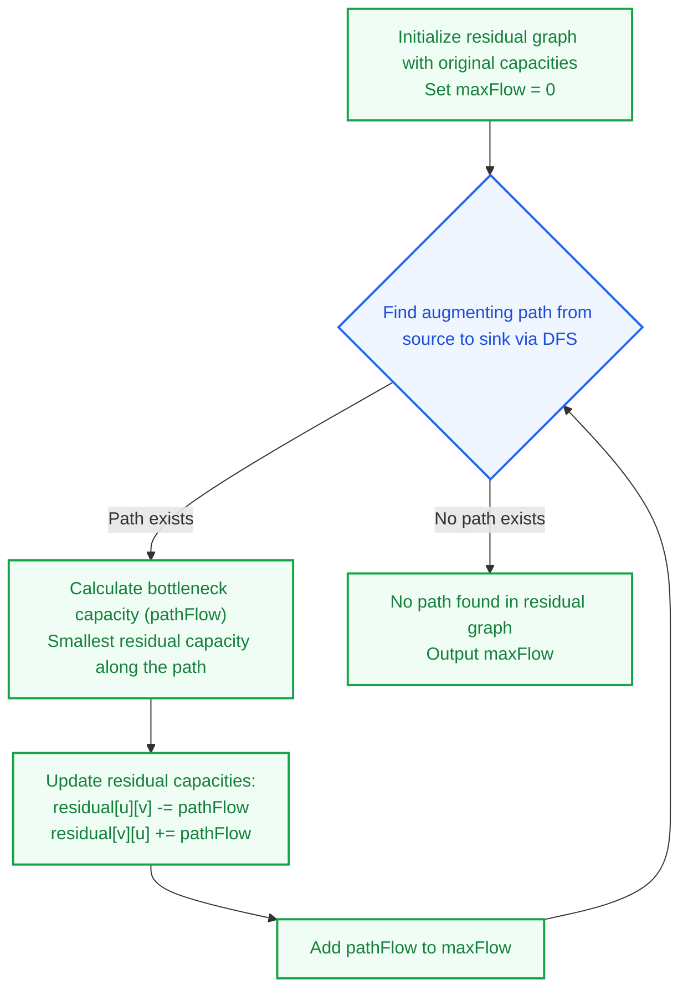
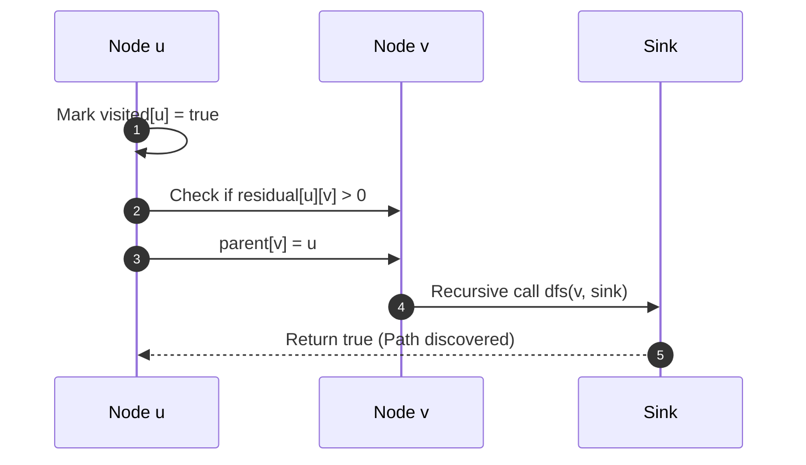
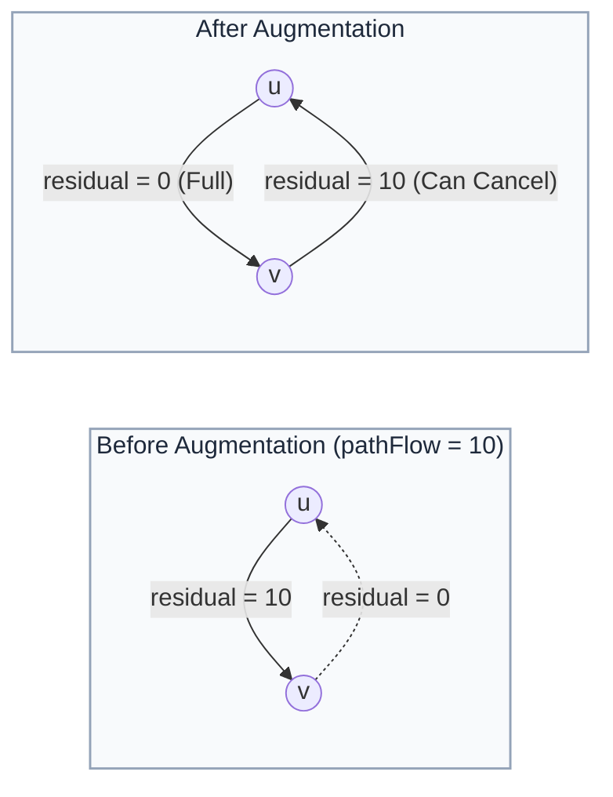

# Ford-Fulkerson Algorithm: Maximum Network Flow

> **Summary:**  
> The Ford-Fulkerson algorithm computes the maximum possible flow in a network.  
> It repeatedly discovers augmenting paths using Depth-First Search (DFS) until no capacity remains.

---

## 1. Definition

A **flow network** is a directed graph where each edge has a specified **capacity**.  
The network contains two distinct nodes:
* **Source ($s$):** The node that produces flow.
* **Sink ($t$):** The node that consumes flow.

The objective of the algorithm is to maximize total flow from the source to the sink.



### Governing Rules
1. **Capacity Rule:** The flow on any edge cannot exceed the capacity of that edge ($0 \le \text{flow} \le \text{capacity}$).
2. **Conservation Rule:** For all intermediate nodes, incoming flow must equal outgoing flow.

---

## 2. Procedure

The algorithm executes through iterative residual graph updates:



### The Residual Graph and Reverse Edges
1. **Forward Residual Edge:** Stores the remaining capacity available to push additional flow:
   $$\text{residual}[u][v] = \text{capacity}[u][v] - \text{flow}[u][v]$$
2. **Reverse Residual Edge:** Stores the current flow value:
   $$\text{residual}[v][u] = \text{flow}[u][v]$$
   The reverse edge allows the algorithm to cancel or redirect previously routed flow.

---

## 3. Step-by-Step Code and Description

All code examples refer to [`algorithms/flow/FordFulkerson.java`](file:///Users/manthan/Desktop/DSA3/algorithms/flow/FordFulkerson.java).

---

### Part 1: Finding an Augmenting Path with DFS

The `dfs` method traverses the residual graph to find a path from current node `u` to `sink`.  
It records predecessor nodes in the `parent` array to enable path reconstruction.

```java
static boolean dfs(int[][] residual, int u, int sink,
        boolean[] visited, int[] parent) {

    visited[u] = true;

    // Base condition: sink reached
    if (u == sink) {
        return true;
    }

    // Traverse neighbors with available residual capacity
    for (int v = 0; v < residual.length; v++) {
        if (!visited[v] && residual[u][v] > 0) {
            parent[v] = u;

            if (dfs(residual, v, sink, visited, parent)) {
                return true;
            }
        }
    }

    return false;
}
```



---

### Part 2: Calculating Bottleneck Capacity

Trace backwards from `sink` to `source` using the `parent` array.  
Identify the edge with the minimum residual capacity.

```java
int pathFlow = Integer.MAX_VALUE;

for (int v = sink; v != source; v = parent[v]) {
    int u = parent[v];
    pathFlow = Math.min(pathFlow, residual[u][v]);
}
```

**Purpose:**  
The bottleneck capacity is the maximum additional flow that can pass through this path without exceeding edge limits.

---

### Part 3: Updating Residual Capacities

Subtract `pathFlow` from forward edges and add `pathFlow` to reverse edges.

```java
for (int v = sink; v != source; v = parent[v]) {
    int u = parent[v];
    residual[u][v] -= pathFlow;
    residual[v][u] += pathFlow;
}

maxFlow += pathFlow;
```



---

## 4. Execution Trace

The graph in [`algorithms/flow/FordFulkerson.java`](file:///Users/manthan/Desktop/DSA3/algorithms/flow/FordFulkerson.java#L66-L71) contains 4 nodes ($0=\text{Source}, 1, 2, 3=\text{Sink}$):

### Iteration 1
1. **DFS Traversal:** Path found: $0 \to 1 \to 3$.
2. **Bottleneck:**
   * Edge $(0, 1)$ residual = 10
   * Edge $(1, 3)$ residual = 10
   * $\text{pathFlow} = \min(10, 10) = 10$.
3. **Residual Updates:**
   * $\text{residual}[0][1] = 10 - 10 = 0$
   * $\text{residual}[1][0] = 0 + 10 = 10$
   * $\text{residual}[1][3] = 10 - 10 = 0$
   * $\text{residual}[3][1] = 0 + 10 = 10$
4. **Current maxFlow:** $0 + 10 = 10$.

### Iteration 2
1. **DFS Traversal:** Path found: $0 \to 2 \to 3$.
2. **Bottleneck:**
   * Edge $(0, 2)$ residual = 5
   * Edge $(2, 3)$ residual = 10
   * $\text{pathFlow} = \min(5, 10) = 5$.
3. **Residual Updates:**
   * $\text{residual}[0][2] = 5 - 5 = 0$
   * $\text{residual}[2][0] = 0 + 5 = 5$
   * $\text{residual}[2][3] = 10 - 5 = 5$
   * $\text{residual}[3][2] = 0 + 5 = 5$
4. **Current maxFlow:** $10 + 5 = 15$.

### Iteration 3
1. **DFS Traversal:**
   * Start at Node 0.
   * $\text{residual}[0][1] = 0$ and $\text{residual}[0][2] = 0$.
   * No unvisited neighbors with positive residual capacity remain.
   * DFS returns `false`.
2. **Termination:** Algorithm terminates.
3. **Final Result:** Output = `15`.

---

## 5. Technical Complexity

| Parameter | Value | Technical Reason |
| :--- | :--- | :--- |
| **Time Complexity** | $\mathcal{O}(E \cdot \text{max flow})$ | Each DFS traversal takes $\mathcal{O}(E)$ time. In the worst case, each path augments flow by 1 unit. |
| **Space Complexity** | $\mathcal{O}(V^2)$ | Requires an adjacency matrix of size $V \times V$ to store residual capacities. |

---

## 6. Technical Questions and Answers

* **Question: What is an augmenting path?**  
  **Answer:** It is a directed path from source to sink in the residual graph where every edge has residual capacity greater than zero.

* **Question: Why do we add reverse edges in the residual graph?**  
  **Answer:** Reverse edges allow the algorithm to cancel or reroute previously pushed flow if a better global route exists.

* **Question: When does the Ford-Fulkerson algorithm terminate?**  
  **Answer:** It terminates when the DFS cannot find any path from source to sink with positive residual capacity.

* **Question: What is the bottleneck capacity of an augmenting path?**  
  **Answer:** It is the minimum residual capacity among all edges on that augmenting path.
