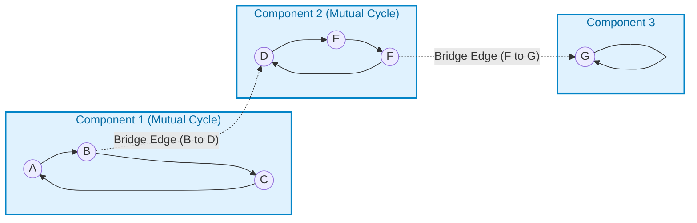
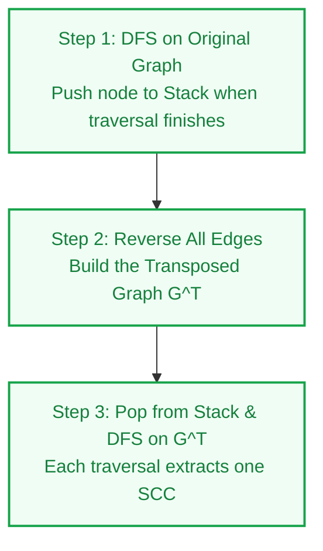
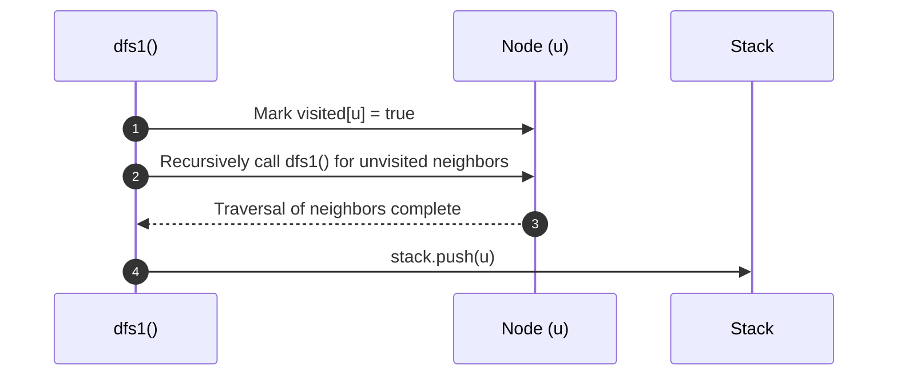
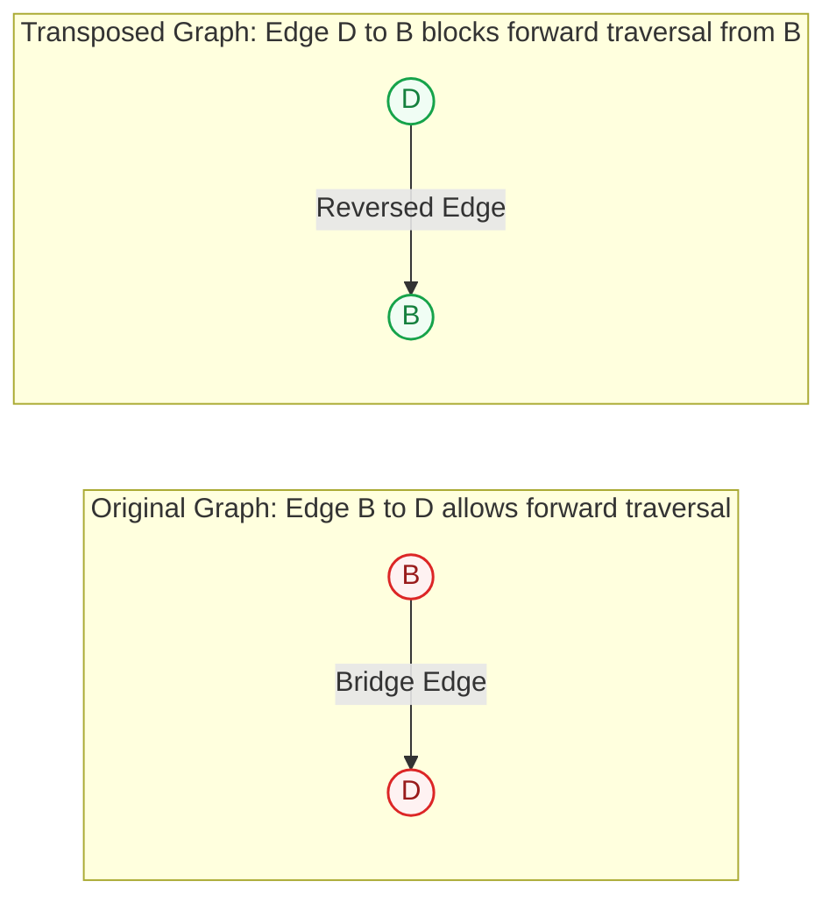

# Kosaraju Algorithm: Strongly Connected Components (SCC)

> **Summary:**  
> The Kosaraju algorithm finds all strongly connected components in a directed graph.  
> It uses two Depth-First Search (DFS) traversals and one graph reversal.

---

## 1. Definition

A **Strongly Connected Component (SCC)** is a sub-graph of a directed graph.  
In an SCC, every node can reach every other node in both directions.

* If a path exists from Node A to Node B, and a path exists from Node B to Node A, then Node A and Node B belong to the same SCC.
* If a path exists from Node A to Node D, but no path exists from Node D to Node A, then Node A and Node D belong to different SCCs.



### The Technical Problem
A standard DFS starts at Node A and traverses all reachable edges.  
It traverses the bridge edge B -> D and the bridge edge F -> G.  
It marks all 7 nodes as visited in one traversal.  
Therefore, a single DFS cannot separate different components.  
The Kosaraju algorithm solves this problem.

---

## 2. Procedure

The algorithm executes three sequential steps:

1. **Step 1:** Run a DFS traversal on the original graph. Push each node to a stack when its traversal finishes.
2. **Step 2:** Reverse the direction of all edges to build the transposed graph ($G^T$).
3. **Step 3:** Pop nodes from the stack. Run a DFS traversal on the transposed graph for each unvisited node.

Each DFS traversal in Step 3 outputs one complete SCC.



### Cause and Effect of Edge Reversal

1. Within an SCC, all nodes form a cycle. Reversing the edges changes the cycle direction, but all nodes remain mutually reachable.
2. Between two different SCCs, an edge exists in only one direction (for example, B -> D). Reversing this edge changes it to D -> B.
3. When the second DFS starts from a node in Component 1, it cannot traverse edge D -> B. The reversed edge blocks traversal into Component 2.

---

## 3. Step-by-Step Code and Description

All code examples refer to [`algorithms/scc/KosarajusAlgo.java`](file:///Users/manthan/Desktop/DSA3/algorithms/scc/KosarajusAlgo.java).

---

### Part 1: Record Finish Times with a Stack

Run a DFS traversal on the graph.  
When a node has no unvisited neighbors, push the node to the stack.

```java
static void dfs1(int node, List<List<Integer>> graph, boolean[] visited, Stack<Integer> stack) {
    visited[node] = true;

    // 1. Visit all unvisited neighbors
    for (int neighbor : graph.get(node)) {
        if (!visited[neighbor]) {
            dfs1(neighbor, graph, visited, stack);
        }
    }

    // 2. Push node to stack when all neighbor paths finish
    stack.push(node);
}
```



**Purpose:**  
The node that finishes last is placed on top of the stack.  
This order ensures that the algorithm processes source components first in Step 3.

---

### Part 2: Reverse All Edges (Graph Transposition)

Create a new adjacency list `reversed`.  
For each directed edge $u \to v$, insert edge $v \to u$.

```java
List<List<Integer>> reversed = new ArrayList<>();
for (int i = 0; i < n; i++) {
    reversed.add(new ArrayList<>());
}

// Invert each edge: if u -> v exists, store v -> u
for (int u = 0; u < n; u++) {
    for (int v : graph.get(u)) {
        reversed.get(v).add(u);
    }
}
```



---

### Part 3: Extract Components from Transposed Graph

Set all elements in the `visited` array to `false`.  
Pop nodes from the stack one by one.  
If a node is not visited, call `dfs2` on the transposed graph.  
All nodes visited during this call belong to the same SCC.

```java
static void dfs2(int node, List<List<Integer>> reversed, boolean[] visited) {
    visited[node] = true;
    System.out.print((char) ('A' + node) + " "); // Print node character

    for (int neighbor : reversed.get(node)) {
        if (!visited[neighbor]) {
            dfs2(neighbor, reversed, visited);
        }
    }
}
```

The component processing loop in `main`:

```java
Arrays.fill(visited, false);
int count = 0;

while (!stack.isEmpty()) {
    int node = stack.pop();

    if (!visited[node]) {
        count++;
        System.out.print("SCC " + count + ": ");
        dfs2(node, reversed, visited);
        System.out.println();
    }
}
```

---

## 4. Execution Trace

The graph in [`algorithms/scc/KosarajusAlgo.java`](file:///Users/manthan/Desktop/DSA3/algorithms/scc/KosarajusAlgo.java#L52-L61) has 7 nodes ($0=\text{A}, 1=\text{B}, 2=\text{C}, 3=\text{D}, 4=\text{E}, 5=\text{F}, 6=\text{G}$):

### Step 1: First DFS Traversal
1. Start traversal at Node A.
2. Traverse: A -> B -> C -> A.
3. Traverse bridge: B -> D -> E -> F -> D.
4. Traverse bridge: F -> G -> G.
5. Finish order:
   * Node G finishes -> Push G to stack.
   * Nodes F, E, D finish -> Push F, E, D to stack.
   * Nodes C, B, A finish -> Push C, B, A to stack.
6. Stack content from top to bottom: `[A, B, C, D, E, F, G]`.

### Step 2: Edge Reversal
* Edge B -> D becomes D -> B.
* Edge F -> G becomes G -> F.

### Step 3: Second DFS Traversal
1. **Pop Node A**:
   * Call `dfs2(A)` on $G^T$.
   * Traversal visits: A, C, B.
   * Traversal stops at Node B because edge D -> B points inward.
   * **Output: `SCC 1: A C B`**
2. **Pop Node B**: Node is visited. Skip.
3. **Pop Node C**: Node is visited. Skip.
4. **Pop Node D**:
   * Call `dfs2(D)` on $G^T$.
   * Traversal visits: D, F, E.
   * Traversal stops at Node F because edge G -> F points inward.
   * **Output: `SCC 2: D F E`**
5. **Pop Node E**: Node is visited. Skip.
6. **Pop Node F**: Node is visited. Skip.
7. **Pop Node G**:
   * Call `dfs2(G)` on $G^T$.
   * Traversal visits: G.
   * **Output: `SCC 3: G`**

---

## 5. Technical Complexity

| Parameter | Value | Technical Reason |
| :--- | :--- | :--- |
| **Time Complexity** | $\mathcal{O}(V + E)$ | Two DFS passes and one edge-reversal pass execute in linear time. |
| **Space Complexity** | $\mathcal{O}(V + E)$ | Requires storage for the transposed adjacency list and the stack. |

---

## 6. Technical Questions and Answers

* **Question: What is a Strongly Connected Component?**  
  **Answer:** It is a sub-graph where every node can reach every other node in both directions.

* **Question: Why does a single DFS fail to separate SCCs?**  
  **Answer:** A single DFS traverses one-way cross-component edges and groups multiple components into one.

* **Question: Why must you reverse all edges?**  
  **Answer:** Edge reversal preserves internal cycles but reverses cross-component edges. This prevents the second DFS from leaving the component.

* **Question: What is the function of the Stack?**  
  **Answer:** The stack orders nodes by finish time. This ensures that the algorithm visits source components first in Step 3.
