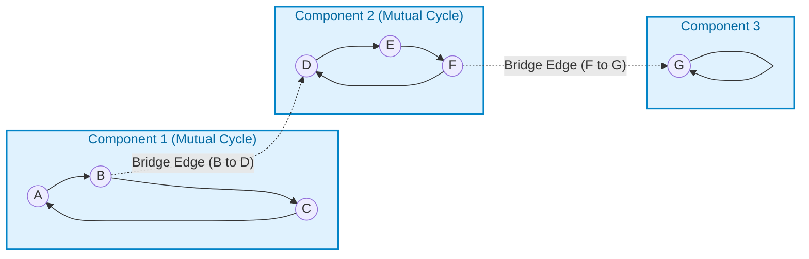
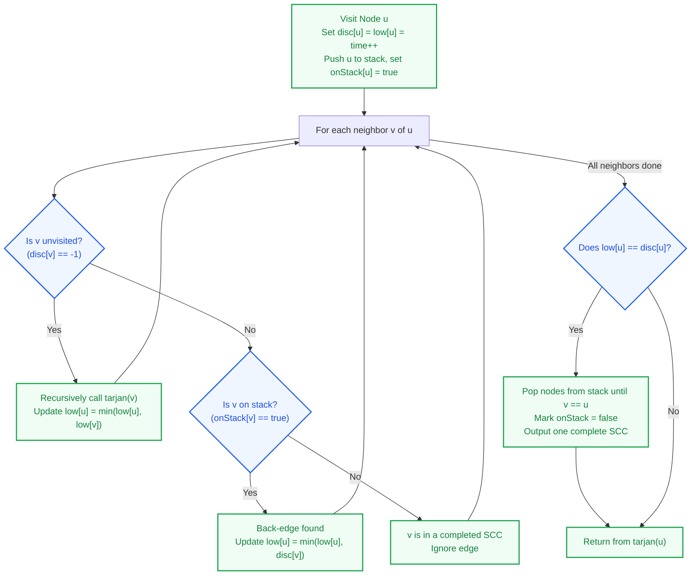
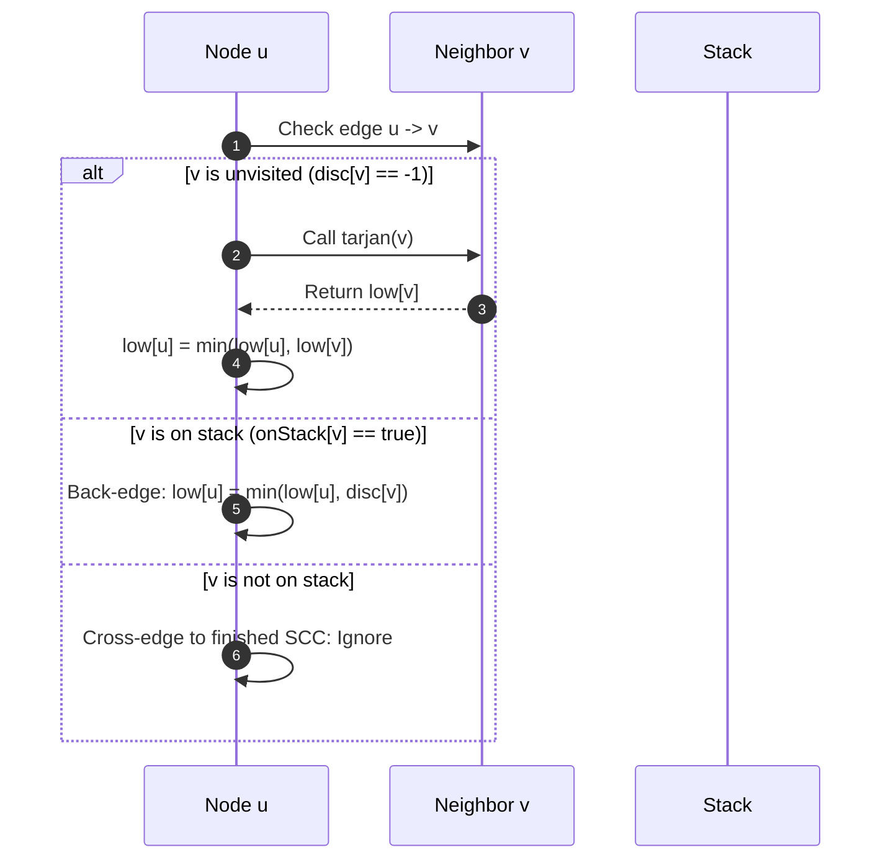

# Tarjan Algorithm: Strongly Connected Components (SCC)

> **Summary:**  
> The Tarjan algorithm finds all strongly connected components in a directed graph.  
> It uses a single Depth-First Search (DFS) traversal, discovery timestamps, and low-link values.

---

## 1. Definition

A **Strongly Connected Component (SCC)** is a maximal sub-graph of a directed graph.  
In an SCC, every node can reach every other node in both directions.

The Tarjan algorithm solves the same problem as the Kosaraju algorithm.  
However, the Tarjan algorithm requires only one DFS pass and does not reverse the graph.



---

## 2. Core Concepts

The algorithm tracks four data structures:

| Data Structure | Type | Purpose |
| :--- | :--- | :--- |
| `disc[]` | `int[]` | Stores the discovery time when the algorithm first visits a node. Initialized to -1. |
| `low[]` | `int[]` | Stores the lowest discovery time reachable from the node. |
| `stack` | `Stack<Integer>` | Stores nodes that currently belong to the active search path. |
| `onStack[]` | `boolean[]` | Indicates if a node is currently in the stack for fast lookup. |

### Low-Link Value Logic
The low-link value `low[u]` represents the oldest ancestor reachable from node `u`.  
When `low[u] == disc[u]`, node `u` cannot reach any ancestor above it.  
Therefore, node `u` is the root of an SCC.



---

## 3. Step-by-Step Code and Description

All code examples refer to [`algorithms/scc/TarjanAlgo.java`](file:///Users/manthan/Desktop/DSA3/algorithms/scc/TarjanAlgo.java).

---

### Part 1: State Initialization and Node Discovery

When visiting node `u`, assign the current timestamp to both `disc[u]` and `low[u]`.  
Push node `u` to the stack and set `onStack[u] = true`.

```java
static void tarjan(int u) {
    disc[u] = low[u] = time++;
    stack.push(u);
    onStack[u] = true;
```

**Purpose:**  
Each node receives a unique timestamp.  
The stack preserves the order of discovery.

---

### Part 2: Edge Traversal and Low-Link Updates

Iterate through each neighbor `v` of node `u`.  
Update `low[u]` based on the status of neighbor `v`.

```java
    for (int v : graph.get(u)) {
        if (disc[v] == -1) {
            // Case 1: Neighbor is not visited yet
            tarjan(v);
            low[u] = Math.min(low[u], low[v]);
        } else if (onStack[v]) {
            // Case 2: Neighbor is an ancestor currently on the stack
            low[u] = Math.min(low[u], disc[v]);
        }
        // Case 3: Neighbor is visited and not on stack -> belongs to another SCC -> ignore
    }
```



**Why `onStack[v]` is necessary:**  
Cross-edges can point to nodes in previously extracted SCCs.  
The `onStack[v]` check prevents already closed components from altering `low[u]`.

---

### Part 3: Component Extraction

After checking all neighbors, check if `low[u] == disc[u]`.  
If true, node `u` is the root node of an SCC.  
Pop nodes from the stack until node `u` is removed.

```java
    if (low[u] == disc[u]) {
        System.out.print("SCC: ");
        int v;
        do {
            v = stack.pop();
            onStack[v] = false;
            System.out.print((char) ('A' + v) + " ");
        } while (v != u);
        System.out.println();
    }
}
```

---

## 4. Execution Trace

The graph in [`algorithms/scc/TarjanAlgo.java`](file:///Users/manthan/Desktop/DSA3/algorithms/scc/TarjanAlgo.java#L47-L80) has 7 nodes ($0=\text{A}, 1=\text{B}, 2=\text{C}, 3=\text{D}, 4=\text{E}, 5=\text{F}, 6=\text{G}$):

### Trace Table

| Step | Action | Node | `disc` | `low` | Stack Contents | Notes |
| :--- | :--- | :--- | :--- | :--- | :--- | :--- |
| 1 | Visit | A (0) | 0 | 0 | `[A]` | Start DFS |
| 2 | Visit | B (1) | 1 | 1 | `[A, B]` | Edge A -> B |
| 3 | Visit | C (2) | 2 | 2 | `[A, B, C]` | Edge B -> C |
| 4 | Edge | C -> A | - | - | `[A, B, C]` | A is on stack. `low[C] = min(2, disc[A]) = 0` |
| 5 | Return | C to B | - | - | `[A, B, C]` | `low[B] = min(1, low[C]) = 0` |
| 6 | Edge | B -> D | - | - | `[A, B, C]` | Traversal branches into D |
| 7 | Visit | D (3) | 3 | 3 | `[A, B, C, D]` | Edge B -> D |
| 8 | Visit | E (4) | 4 | 4 | `[A, B, C, D, E]` | Edge D -> E |
| 9 | Visit | F (5) | 5 | 5 | `[A, B, C, D, E, F]` | Edge E -> F |
| 10 | Edge | F -> D | - | - | `[A, B, C, D, E, F]` | D is on stack. `low[F] = min(5, disc[D]) = 3` |
| 11 | Visit | G (6) | 6 | 6 | `[A, B, C, D, E, F, G]` | Edge F -> G |
| 12 | Edge | G -> G | - | - | `[A, B, C, D, E, F, G]` | Self-loop on G |
| 13 | Pop SCC | G (6) | 6 | 6 | `[A, B, C, D, E, F]` | `low[G] == disc[G]`. **Output: SCC: G** |
| 14 | Return | F to E to D | - | 3 | `[A, B, C, D, E, F]` | `low[E]=3`, `low[D]=3` |
| 15 | Pop SCC | D (3) | 3 | 3 | `[A, B, C]` | `low[D] == disc[D]`. Pop F, E, D. **Output: SCC: F E D** |
| 16 | Return | B to A | - | 0 | `[A, B, C]` | `low[A] = 0` |
| 17 | Pop SCC | A (0) | 0 | 0 | `[]` | `low[A] == disc[A]`. Pop C, B, A. **Output: SCC: C B A** |

---

## 5. Technical Complexity

| Parameter | Value | Technical Reason |
| :--- | :--- | :--- |
| **Time Complexity** | $\mathcal{O}(V + E)$ | Each vertex and edge is processed once during the single DFS pass. |
| **Space Complexity** | $\mathcal{O}(V)$ | Requires storage for arrays `disc`, `low`, `onStack`, and the recursion stack. |

---

## 6. Technical Questions and Answers

* **Question: How does Tarjan algorithm differ from Kosaraju algorithm?**  
  **Answer:** Tarjan algorithm uses one DFS pass and no graph reversal. Kosaraju algorithm uses two DFS passes and reverses the graph.

* **Question: What is a low-link value?**  
  **Answer:** It is the smallest discovery time of any node reachable from the current subtree through back-edges.

* **Question: When does the algorithm identify an SCC root?**  
  **Answer:** A node `u` is an SCC root when `low[u] == disc[u]`.

* **Question: Why do we use the onStack array?**  
  **Answer:** It prevents cross-edges to previously extracted components from incorrectly lowering the low-link value.
