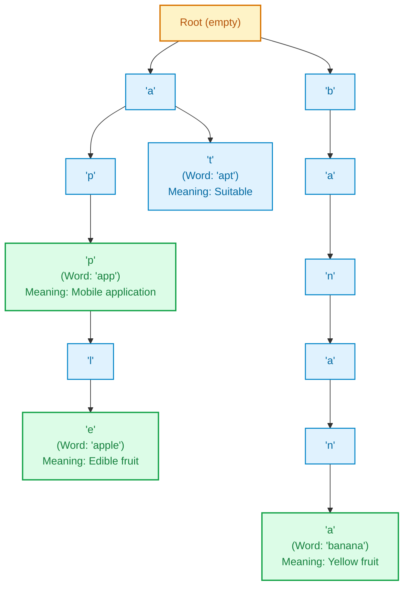

# Internal Mini-Project: Trie-Based Dictionary and Autocomplete

**Course:** Data Structures & Algorithms III (DSA 3)  
**Project Number:** Project 15 (from 30 Internal Project Titles)  
**Language:** Java  
**Code File:** [`project/TrieDictionary.java`](file:///Users/manthan/Desktop/DSA3/project/TrieDictionary.java)

---

## 1. Problem Statement

When you type in a search engine like Google or use your phone's keyboard, you see suggestions before you finish typing. This is called **autocomplete**.

### Why Not Use a Normal List or HashMap?
- **List / Array:** Searching through a big list of words one by one is very slow.
- **HashMap:** A HashMap is fast for finding an exact word, but it **cannot do prefix search**. To find words starting with `"ap"`, a HashMap has to look through every single word in the entire database.
- **Wasted Memory:** If we store `"app"`, `"apple"`, and `"application"` separately, the letters `"app"` are repeated in memory three times.

### The Solution: A Trie (Prefix Tree)
A **Trie** is a tree where each node stores a single letter. Words that share the same starting letters share the same branch. 
- For example, `"app"`, `"apple"`, and `"apt"` all share the root letters `'a'` and `'p'`.
- This makes searching and autocomplete extremely fast, because the program only looks at the letters you typed, not the entire dictionary.

---

## 2. Project Goals

1. **Add Words:** Add words along with their short definitions.
2. **Search Words:** Look up a word to get its meaning in quick time.
3. **Autocomplete:** Type a prefix like `"ap"` and get all words starting with those letters.
4. **Delete Words Safely:** Remove a word without breaking other words (e.g., deleting `"app"` should not delete `"apple"`).
5. **Testing:** Run automated test cases showing normal search, autocomplete, deletion, and edge cases.

---

## 3. How the Trie is Structured

Here is a simple picture of how words are stored in the tree:



### The Node Design (`TrieNode`)
Each box in the tree has three simple parts:
```java
static class TrieNode {
    Map<Character, TrieNode> children = new TreeMap<>();
    boolean isEndOfWord = false;
    String definition = null;
}
```
1. **`children`**: Stores links to the next letters (uses `TreeMap` so words come out sorted in A-to-Z order).
2. **`isEndOfWord`**: A flag set to `true` if a full word ends at this letter.
3. **`definition`**: The meaning of the word (saved at the last letter).

---

## 4. How the Code Works

### A. Inserting a Word (`insert`)
1. Start at the root node.
2. Look at each letter of the word one by one.
3. If the letter is not in the tree yet, create a new node for it.
4. Move down to that child node.
5. At the final letter, set `isEndOfWord = true` and save the definition.

### B. Searching for a Word (`search`)
1. Start at the root node.
2. Follow the letters of the word down the branches.
3. If any letter is missing, the word does not exist $\rightarrow$ return `null`.
4. If all letters exist, check if `isEndOfWord` is `true`.
   - If true, return the definition.
   - If false, it means we only found a prefix (e.g., searching for `"appl"` when only `"apple"` exists), so return `null`.

### C. Autocomplete (`autocomplete`)
1. Walk down the tree to the end of the given prefix (e.g., `'a'` then `'p'`).
2. If the prefix doesn't exist, return an empty list.
3. From that prefix node, use a simple search (DFS) to visit all letters below it and collect every word that has `isEndOfWord == true`.

### D. Deleting a Word (`delete`)
1. Find the word in the tree.
2. Set its `isEndOfWord = false` so it is no longer considered a word.
3. If that node has no other letters branching off it, remove it to keep the tree clean.

---

## 5. Time and Space Complexity

| Operation | Time Taken | Memory Used | Simple Explanation |
| :--- | :---: | :---: | :--- |
| **Insert** | $\mathcal{O}(L)$ | $\mathcal{O}(L)$ | Only takes steps equal to the word length ($L$). |
| **Search** | $\mathcal{O}(L)$ | $\mathcal{O}(1)$ | Only checks the letters in the word ($L$). Very fast. |
| **Autocomplete** | $\mathcal{O}(P + K)$ | $\mathcal{O}(P + K)$ | Walks the prefix ($P$), then visits the matching words ($K$). |
| **Delete** | $\mathcal{O}(L)$ | $\mathcal{O}(L)$ | Finds the word and unmarks it in $L$ steps. |

*(Note: $L$ is the length of the word, $P$ is the prefix length, and $K$ is the length of matched suggestions).*

---

## 6. Test Cases & Results

The project runs 4 automated test cases to prove everything works:

### Test Case 1: Exact Word Search
* **Input words added:** `"apple"`, `"app"`, `"application"`, `"apt"`, `"banana"`.
* **Search `"apple"`:** Found $\rightarrow$ prints definition.
* **Search `"app"`:** Found $\rightarrow$ prints definition.
* **Search `"appl"`:** Returns `null` (correctly detects that `"appl"` is just a prefix, not a full word).

### Test Case 2: Autocomplete
* **Prefix entered:** `"ap"`
* **Output:** `[app, apple, application, apt]` (all 4 words starting with `"ap"`, sorted alphabetically).

### Test Case 3: Safe Deletion
* **Action:** Delete the word `"app"`.
* **Search `"app"` after deletion:** Returns `null` (successfully removed).
* **Search `"apple"` after deletion:** Still found (proves child words are not accidentally deleted).
* **Autocomplete for `"ap"`:** Returns `[apple, application, apt]`.

### Test Case 4: Edge Cases
* **Empty string search `""`:** Handled safely, returns `null` without crashing.
* **Non-existent prefix `"xyz"`:** Returns `[]` without error.
* **Case insensitivity `"BaNaNa"`:** Automatically converts to lowercase and finds the word.

---

## 7. How to Compile and Run

From the root project directory:

```bash
# 1. Compile the Java file
javac project/TrieDictionary.java

# 2. Run the program
java project.TrieDictionary
```

### Output Screen:
```text
=================================================
   TRIE DICTIONARY & AUTOCOMPLETE DEMONSTRATION  
=================================================

[TEST 1] Exact Word Search:
 - Search 'apple': A sweet red or green fruit.
 - Search 'app':   A mobile or desktop application.
 - Search 'appl':  null (Prefix only -> null)

[TEST 2] Autocomplete Suggestions for Prefix 'ap':
 - Results: [app, apple, application, apt]

[TEST 3] Safe Deletion of 'app':
 - Search 'app' post-delete:   null (Deleted)
 - Search 'apple' post-delete: A sweet red or green fruit. (Preserved)
 - Autocomplete for 'ap':      [apple, application, apt]

[TEST 4] Edge Cases:
 - Empty query search:     null
 - Non-existent prefix:    []
 - Case-insensitive lookup: A long yellow fruit.
=================================================
```
