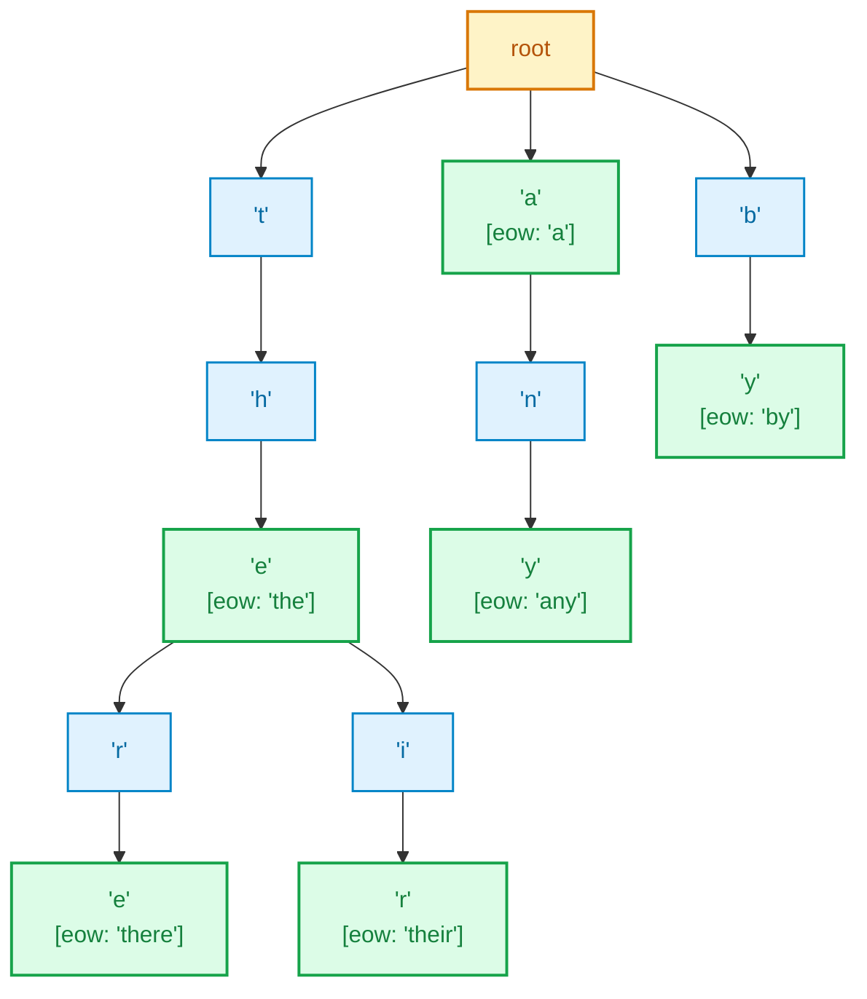

# Internal Project Report: Trie-Based Word Search and Autocomplete Engine

**Course:** Data Structures & Algorithms III (DSA 3)  
**Project Number:** Project 15 (from 30 Internal Project Titles)  
**Deliverable File:** [`project/Trie.java`](file:///Users/manthan/Desktop/DSA3/project/Trie.java)  
**Programming Language:** Java (Standard Library)  

---

## 1. Problem Statement

Text retrieval systems, IDE IntelliSense, and search bars require rapid prefix lookups and word auto-suggestions. 

### Limitations of Traditional Data Structures
1. **Arrays / Lists:** A linear scan takes $\mathcal{O}(N \cdot L)$ time to find words matching a prefix, where $N$ is the number of words and $L$ is word length. Even binary search on a sorted array takes $\mathcal{O}(L \log N)$ and requires expensive array re-indexing on inserts.
2. **Hash Tables (HashMap / HashSet):** Hash tables offer $\mathcal{O}(L)$ average time for exact lookups, but **cannot perform prefix queries or autocomplete**. To locate words starting with `"th"`, a hash table must scan all $N$ keys in memory ($\mathcal{O}(N \cdot L)$).
3. **Memory Redundancy:** Storing words like `"the"`, `"there"`, and `"their"` independently duplicates common prefixes multiple times in memory.

### Solution: Trie (Prefix Tree)
A **Trie** is an $m$-ary tree where each node represents an individual character. Strings sharing common prefixes share the same path from the root. 
- Prefix queries run in $\mathcal{O}(P)$ time, where $P$ is the length of the prefix.
- Autocomplete suggestions run in $\mathcal{O}(P + K)$ time, where $K$ is the number of characters explored in matching descendant nodes, completely independent of the total word count $N$.

---

## 2. Project Objectives

1. **Trie Construction:** Implement a Trie data structure supporting lowercase English letters (`'a'` to `'z'`).
2. **Word Insertion:** Store words in $\mathcal{O}(L)$ time complexity.
3. **Exact Word Search:** Validate full word presence in $\mathcal{O}(L)$ time, distinguishing complete words from intermediate prefixes.
4. **Prefix Search (`startsWith`):** Verify whether any word in the dataset begins with a specified prefix in $\mathcal{O}(P)$ time.
5. **Autocomplete Suggestions:** Return all valid words matching a given prefix using Depth-First Search (DFS) subtree traversal.
6. **Empirical Validation:** Execute test cases covering exact matches, prefix checks, autocomplete expansion, and edge cases.

---

## 3. Data Structure Design

### Node Structure (`Node`)
Each node in the Trie is defined as follows:
```java
static class Node {
    Node[] children;
    boolean eow;

    public Node() {
        children = new Node[26]; // Indices 0 to 25 represent 'a' through 'z'
        for (int i = 0; i < 26; i++) {
            children[i] = null;
        }
        eow = false;
    }
}
```

* **`children` Array:** An array of size 26 storing references to next-character child nodes. The index is mapped via character subtraction: `idx = ch - 'a'`.
* **`eow` (End of Word):** A boolean flag marking the terminal character of a valid stored word. This differentiates complete words from prefixes.

### Trie Hierarchy for Dataset: `{"the", "a", "there", "their", "any", "by"}`



---

## 4. Algorithm Implementation

### A. Word Insertion (`insert(String word)`)
* **Time Complexity:** $\mathcal{O}(L)$
* **Algorithm:**
  1. Initialize pointer `Node curr = root`.
  2. For each character at position `i` in `word`:
     - Calculate index: `idx = word.charAt(i) - 'a'`.
     - If `curr.children[idx] == null`, allocate a new `Node`.
     - Advance pointer: `curr = curr.children[idx]`.
  3. At the last character (`i == word.length() - 1`), set `curr.eow = true`.

### B. Exact Search (`search(String key)`)
* **Time Complexity:** $\mathcal{O}(L)$
* **Algorithm:**
  1. Initialize pointer `Node curr = root`.
  2. For each character in `key`:
     - Calculate index `idx = key.charAt(i) - 'a'`.
     - If `curr.children[idx] == null`, the path does not exist; return `false`.
     - If at the final character and `node.eow == false`, the query is a prefix, not a full word; return `false`.
     - Advance pointer: `curr = curr.children[idx]`.
  3. Return `true` if the entire path is traversed and `eow` is validated.

### C. Prefix Search (`startsWith(String prefix)`)
* **Time Complexity:** $\mathcal{O}(P)$
* **Algorithm:**
  1. Initialize pointer `Node curr = root`.
  2. Traverse through each character in `prefix`.
  3. If at any step `curr.children[idx] == null`, return `false`.
  4. Advance pointer `curr = curr.children[idx]`.
  5. If loop completes, the prefix exists in the Trie; return `true` (ignoring `eow`).

### D. Autocomplete Suggestions (`autocomplete(String prefix)`)
* **Time Complexity:** $\mathcal{O}(P + K)$
* **Algorithm:**
  1. Initialize `List<String> results = new ArrayList<>()`.
  2. Traverse down to the terminal node of `prefix`. If any node is missing, return `results` (empty).
  3. Invoke recursive helper `collectWords(curr, prefix, results)`.
  4. Return populated `results` list.

### E. DFS Subtree Collector (`collectWords(Node curr, String word, List<String> results)`)
* **Time Complexity:** $\mathcal{O}(K)$
* **Algorithm:**
  1. If `curr.eow == true`, add `word` to `results`.
  2. Iterate through all 26 possible child branches (`i` from 0 to 25):
     - If `curr.children[i] != null`:
       - Derive character: `char ch = (char) ('a' + i)`.
       - Recurse: `collectWords(curr.children[i], word + ch, results)`.

---

## 5. Complexity Analysis

| Operation | Time Complexity | Auxiliary Space Complexity | Explanation |
| :--- | :---: | :---: | :--- |
| **`insert`** | $\mathcal{O}(L)$ | $\mathcal{O}(L)$ | Traverses $L$ characters; allocates at most $L$ new nodes for unique paths. |
| **`search`** | $\mathcal{O}(L)$ | $\mathcal{O}(1)$ | Follows $L$ pointers; allocates no dynamic memory. |
| **`startsWith`** | $\mathcal{O}(P)$ | $\mathcal{O}(1)$ | Traverses $P$ prefix characters without backtracking. |
| **`autocomplete`** | $\mathcal{O}(P + K)$ | $\mathcal{O}(K)$ | Traverses $P$ prefix steps, then executes DFS across $K$ descendant characters. Space bounded by recursion stack depth. |

*Notation: $L$ = word length, $P$ = prefix length, $K$ = total characters traversed in matching subtree branches.*

---

## 6. Test Suite and Output Verification

The dataset loaded into the Trie:
```java
String words[] = { "the", "a", "there", "their", "any", "by" };
```

### Test Cases

1. **Exact Word Search:**
   - `search("their")` $\to$ Returns `true` (present with `eow = true`).
   - `search("any")` $\to$ Returns `true` (present with `eow = true`).
   - `search("thi")` $\to$ Returns `false` (prefix path does not exist).
   - `search("abc")` $\to$ Returns `false` (unrelated missing word).

2. **Prefix Search (`startsWith`):**
   - `startsWith("any")` $\to$ Returns `true` (prefix matches word `"any"`).
   - `startsWith("th")` $\to$ Returns `true` (matches `"the"`, `"there"`, `"their"`).
   - `startsWith("abc")` $\to$ Returns `false` (no word shares prefix).

3. **Autocomplete Suggestions:**
   - `autocomplete("th")` $\to$ Returns `[the, their, there]`.
   - `autocomplete("a")` $\to$ Returns `[a, any]`.
   - `autocomplete("xyz")` $\to$ Returns `[]` (edge case: non-existent prefix handled safely).

---

## 7. How to Compile and Execute

Execute the following commands from the project root directory:

```bash
# Compile
javac project/Trie.java

# Run
java project.Trie
```

### Program Console Output
```text
true
true
false
false
true
true
false
Autocomplete for 'th':  [the, their, there]
Autocomplete for 'a':   [a, any]
Autocomplete for 'xyz': []
```
