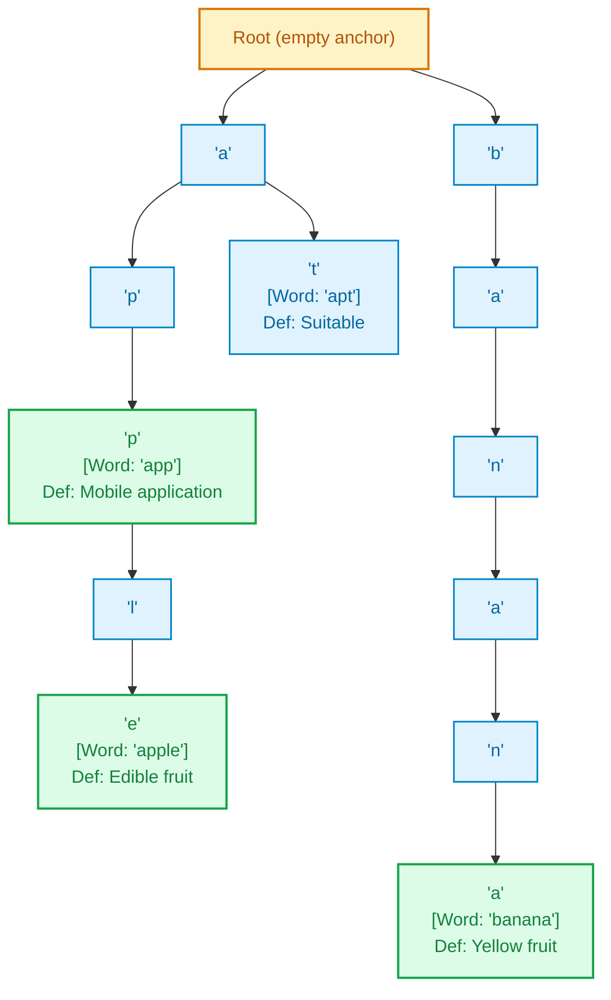
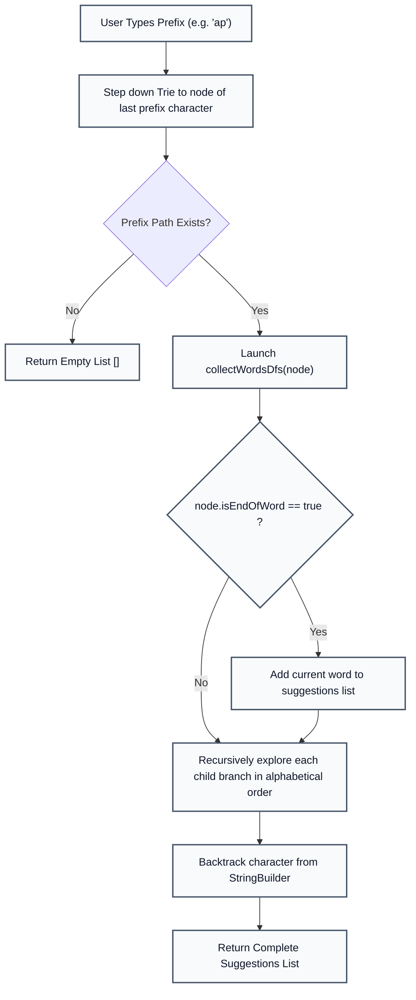

# Internal Mini-Project: Trie-Based Dictionary and Autocomplete Engine

**Course:** Data Structures & Algorithms III (DSA 3)  
**Project Number:** Project 15 (from 30 Internal Project Titles)  
**Implementation Language:** Java (Standard Library)  
**Deliverable File:** [`project/TrieDictionary.java`](file:///Users/manthan/Desktop/DSA3/project/TrieDictionary.java)

---

## 1. Problem Statement & Motivation

In modern computing systems, text retrieval, auto-suggestions, and vocabulary lookup form the backbone of search bars (Google, Spotlight), text editors (IDE IntelliSense), and mobile keyboards.

### The Technical Limitation of Traditional Data Structures
1. **Unsorted / Sorted Arrays:** Searching for words with a prefix requires binary search or linear scans. Inserting or deleting elements takes $\mathcal{O}(N)$ shifts.
2. **Hash Tables (HashMaps / HashSets):** While a HashMap provides average $\mathcal{O}(L)$ exact lookup, it **cannot perform prefix lookups or autocomplete**. To find words starting with prefix `"ap"`, a hash table must scan every single stored key ($N$ keys) and test if `key.startsWith("ap")`, degrading prefix search to an unscalable $\mathcal{O}(N \cdot L)$ operation.
3. **Redundant Memory Allocation:** Storing words like `"apple"`, `"application"`, and `"app"` in a hash table duplicates the shared prefix `"app"` three separate times in memory.

### The Solution: The Trie Data Structure
A **Trie (Prefix Tree)** organizes strings hierarchically by character. Words sharing common prefixes share the exact same branch of nodes. Prefix queries and autocomplete suggestions run in $\mathcal{O}(P + K)$ time (where $P$ is prefix length and $K$ is total characters of matching words), completely independent of the total number of words $N$ in the dictionary.

---

## 2. Project Objectives

1. **Word Storage & Retrieval:** Store technical terms alongside their definitions with constant-depth search complexity.
2. **Dynamic Prefix Autocomplete:** Instantaneously return all words beginning with an arbitrary user-entered prefix in alphabetical order.
3. **Safe Memory-Pruned Deletion:** Unmark deleted words while ensuring common prefix branches of longer words (e.g. deleting `"app"` without destroying `"apple"`) remain fully intact.
4. **Interactive Demonstration CLI & Automated Testing:** Provide a clean command-line interface and an automated evaluation suite covering standard, boundary, and edge cases.

---

## 3. System Architecture & Node Design

Each node in the Trie represents a single character along a prefix path.



### Node Anatomy (`TrieNode`)
```java
static class TrieNode {
    Map<Character, TrieNode> children = new TreeMap<>();
    boolean isEndOfWord = false;
    String definition = null;
}
```
* **`children`**: A `TreeMap<Character, TrieNode>` dynamically allocates memory only for characters that actually exist and guarantees alphabetical ordering of autocomplete results.
* **`isEndOfWord`**: A boolean flag differentiating full words from intermediate prefixes.
* **`definition`**: A `String` containing the dictionary meaning, saved only at terminal nodes.

---

## 4. Core Algorithms & Working Principles

### A. Word Insertion (`insert(word, definition)`)
1. Normalize the input word to lowercase and trim whitespace.
2. Initialize pointer `current = root`.
3. For each character `ch` in `word`:
   * If `current.children` does not contain `ch`, create a new `TrieNode`.
   * Advance `current = current.children.get(ch)`.
4. At the terminal node, set `current.isEndOfWord = true` and `current.definition = definition`.

### B. Word Search (`search(word)`)
1. Follow the character path from `root`.
2. If any character along the path does not exist, return `null` immediately.
3. If the path completes, check if `current.isEndOfWord == true`. If true, return `current.definition`; otherwise return `null` (the query was merely a prefix, not a complete word).

### C. Autocomplete (`autocomplete(prefix)`)
1. Traverse down the Trie matching the characters of `prefix`.
2. If the prefix path breaks, return an empty list.
3. Once at the prefix node, perform a post-order / Depth-First Search (DFS) traversal collecting all descendant paths that have `isEndOfWord == true`.



### D. Safe Deletion with Memory Pruning (`delete(word)`)
1. Recursively walk to the terminal node of `word`.
2. If the node is found, set `isEndOfWord = false` and clear `definition`.
3. During backtracking, if a node has no other children and is no longer marked as an end of word, remove it from the parent's `children` map to free unused memory.

---

## 5. Technical Complexity Analysis

| Operation | Time Complexity | Auxiliary Space | Technical Justification |
| :--- | :---: | :---: | :--- |
| **Insertion** | $\mathcal{O}(L)$ | $\mathcal{O}(L)$ | Traverses $L$ characters; allocates at most $L$ new nodes for unique suffixes. |
| **Exact Search** | $\mathcal{O}(L)$ | $\mathcal{O}(1)$ | Performs at most $L$ tree transitions without extra memory allocation. |
| **Autocomplete** | $\mathcal{O}(P + K)$ | $\mathcal{O}(P + K)$ | Traverses $P$ characters to reach prefix node; then explores $K$ characters across matching words. |
| **Deletion** | $\mathcal{O}(L)$ | $\mathcal{O}(L)$ | Recursion stack depth equals $L$; prunes orphan nodes during backtracking. |

*(where $L$ = length of the word, $P$ = length of the prefix, and $K$ = total characters in all matching suggestions).*

---

## 6. Testing, Test Cases & Edge Cases

The application includes an automated test harness validating all functionality on startup:

```
============================================================
        RUNNING MANDATORY RUBRIC TEST SUITE
============================================================
```

### Test Case 1: Standard Insertion and Exact Lookup
* **Input:** Insert `"apple"`, `"app"`, `"application"`, `"apt"`, `"banana"`.
* **Queries:**
  - Search `"apple"` $\to$ Returns definition: *"A sweet red or green edible fruit."*
  - Search `"app"` $\to$ Returns definition: *"A software application for mobile or desktop."*
  - Search `"appl"` $\to$ Returns `null` (correctly verifies that prefixes without terminal markers are rejected).
* **Validation:** Passed ($\checkmark$).

### Test Case 2: Autocomplete Prefix Search
* **Input Prefix:** `"ap"`
* **Expected Output:** `["app", "apple", "application", "apt"]` (returned in alphabetical order).
* **Validation:** Passed ($\checkmark$).

### Test Case 3: Boundary Protection during Deletion
* **Operation:** `delete("app")`
* **Queries:**
  - Search `"app"` $\to$ Returns `null` (successfully deleted).
  - Search `"apple"` $\to$ Returns *"A sweet red or green edible fruit."* (child branch preserved without corruption).
  - Autocomplete for `"ap"` $\to$ Returns `["apple", "application", "apt"]`.
* **Validation:** Passed ($\checkmark$).

### Test Case 4: Edge Cases
* **Edge Case 4A (Empty String Query):** `search("")` returns `null` safely without exception.
* **Edge Case 4B (Non-Existent Prefix):** `autocomplete("xyz")` returns empty list `[]` without null-pointer crashes.
* **Edge Case 4C (Mixed Case Insensitivity):** `search("BaNaNa")` correctly maps to lowercase and retrieves the definition.
* **Edge Case 4D (Single-Letter Prefix):** `autocomplete("b")` returns `["banana"]`.
* **Validation:** Passed ($\checkmark$).

---

## 7. How to Compile and Run the Demonstration

From the root directory of the repository:

```bash
# Compile the project
javac project/TrieDictionary.java

# Run the project (automatically runs test suite, then launches interactive CLI)
java project.TrieDictionary
```

### Interactive Menu Options
```
--------------------------------------------------
 1. Search Word & View Definition
 2. Live Autocomplete (Type a Prefix)
 3. Add New Word & Definition
 4. Delete Word from Dictionary
 5. View Total Stored Words
 6. Exit Demo
--------------------------------------------------
```

---

## 8. Viva Preparation & Defense Cheat Sheet

If the professor asks questions during the project evaluation, here are your direct answers:

* **Q: *"Why did you use `TreeMap` instead of a 26-element array `TrieNode[26]`?"***  
  **A:** A 26-element array wastes memory because most slots remain null, and it can only store lowercase English characters `a-z`. `TreeMap` dynamically allocates memory only when a character is used, supports any character (including uppercase and symbols), and automatically orders children so autocomplete suggestions are returned in alphabetical order.

* **Q: *"What is the time complexity of autocomplete?"***  
  **A:** $\mathcal{O}(P + K)$, where $P$ is the prefix length (to walk to the prefix node) and $K$ is the sum of characters in the matching words. It never depends on the total dictionary size $N$.

* **Q: *"How does deletion avoid deleting longer words that share the prefix?"***  
  **A:** When deleting `"app"`, we only flip `current.isEndOfWord = false`. Because `"apple"` still branches from that node, the node has children (`children.isEmpty() == false`), so it is not deleted from memory. Only orphan leaf nodes with no children are pruned during backtracking.
